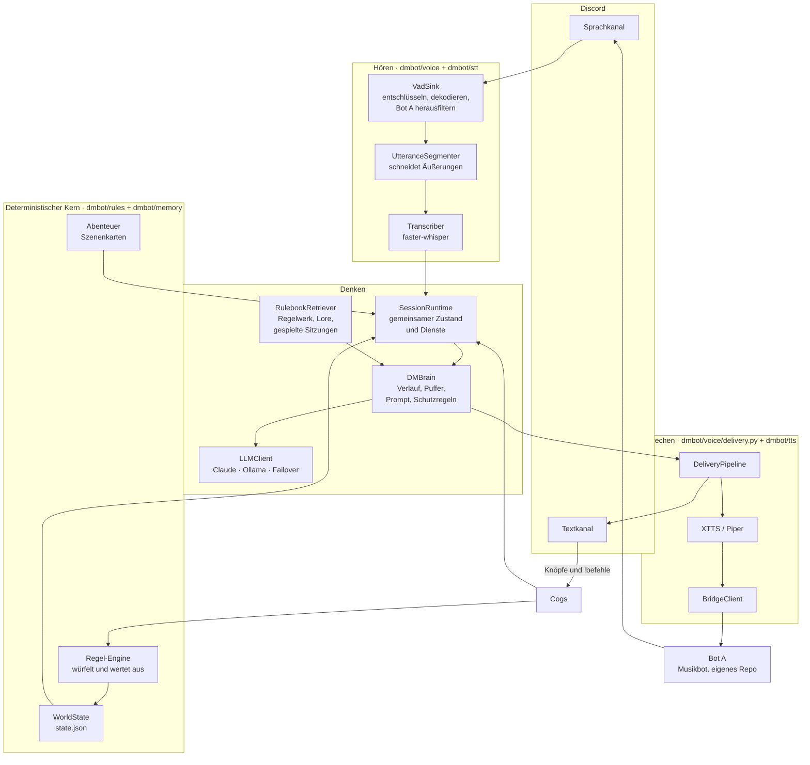
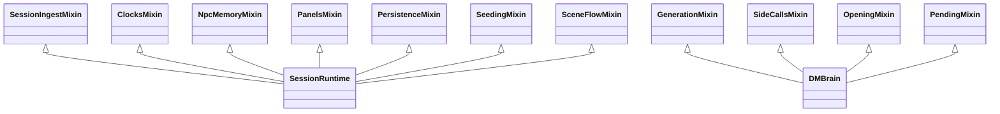
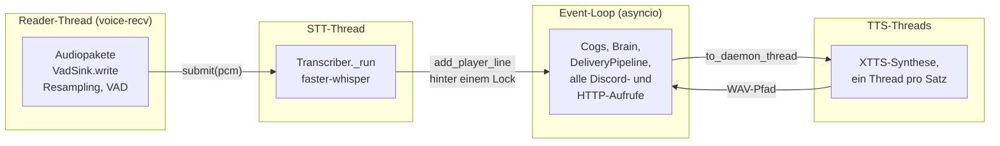

# 1 · Überblick: die Bausteine und wie sie zusammenhängen

Dieses Kapitel ist die Landkarte. Es erklärt noch nicht, *wie* die einzelnen Teile arbeiten,
sondern *welche* es gibt, wer mit wem redet und welche drei Grundideen sich durch das ganze
Repo ziehen. Kapitel 2 läuft danach einen einzelnen Spielzug Schritt für Schritt ab.

## Der Bot in einem Absatz

Die Spieler sitzen in einem Discord-Sprachkanal. Der Bot hört allen zu und schreibt alles mit.
Was im „Knopf-Fenster“ gesagt wird (Mikro-Knopf an, sprechen, Mikro-Knopf aus), geht an die
Spielleitung. Ein Sprachmodell (bei dir Claude, früher Nemo über Ollama) erzählt daraufhin
weiter. Die Antwort wird Satz für Satz in Sprache umgewandelt und im Kanal abgespielt. Alles,
was hart stimmen muss (Würfel, Lebenspunkte, Uhrzeit, in welcher Szene die Gruppe steht),
rechnet Python-Code aus, nie das Sprachmodell.

## Die Karte



Lies die Karte als Kreis: Sprachkanal → Ohr → Denken → Mund → Sprachkanal. Der deterministische
Kern hängt seitlich dran und liefert dem Denken die Fakten.

## Die Bausteine der Reihe nach

### Zwei Bots statt einem

Es laufen zwei Discord-Bots. **DMbot** (dieses Repo) hört zu und denkt. **Bot A** ist dein
Musikbot aus `Pr0degie/musicbot` und spielt nur Audio ab. DMbot schickt ihm über HTTP eine
WAV-Datei (`POST /speak`), und Bot A antwortet erst, wenn die Datei zu Ende gespielt ist.

Warum zwei? Audio *empfangen* ist in discord.py der wackelige Teil (eine Zusatzbibliothek plus
Entschlüsselung). Wenn das abstürzt, läuft der Musikbot weiter. Und Abspielen konnte der
Musikbot schon.

Eine Folge davon musst du dir merken: DMbot hört im Kanal auch Bot A. Ohne Schutz würde er
seine eigene Erzählstimme transkribieren und sich selbst antworten. Deshalb wirft `VadSink`
jedes Audiopaket von Bot As Benutzer-ID weg, bevor irgendetwas anderes passiert. Das ist
„golden rule #4“ und der Grund, warum `BOT_A_USER_ID` in der Config steht.

### Die Cogs: Discords Oberfläche

**Konzept.** Ein *Cog* ist in discord.py eine Klasse, die Befehle (`!join`) und
Ereignis-Handler bündelt. Man hängt mehrere Cogs an einen Bot, damit nicht alles in einer
Datei landet.

**Hier.** `dmbot/__main__.py` baut in `DMBot.setup_hook` genau eine `SessionRuntime` und gibt
sie an neun Cogs weiter:

| Cog | Datei | Zuständig für |
|---|---|---|
| `VoiceCog` | `voice/voicecog.py` | `!join`, `!leave`, Mikro-Knopf, Pause |
| `DMCog` | `voice/dmcog.py` | `!dm`, `!redo`, `!intro`, `!wrap`, Auto-Recap, Backend-Wächter |
| `DiceCog` | `voice/dicecog.py` + `voice/dice/` | Würfelknöpfe, Schaden, Manifestationen, Zugreihenfolge |
| `SceneCog` | `voice/scenecog.py` | `!ort`, `!szenen`, `!erledigt` |
| `NpcCog` | `voice/npccog.py` | `!npc add`, `!npcmem`, `!agenda` |
| `LoreCog` | `voice/lorecog.py` | `!lore` |
| `ClockCog` | `voice/clockcog.py` | `!uhr` |
| `TimeCog` | `voice/timecog.py` | `!zeit`, `!frist` |
| `ChekhovCog` | `voice/chekhovcog.py` | `!faden`, `!fäden` |

Die Cogs sind absichtlich dünn. Sie nehmen einen Befehl oder Knopfdruck entgegen und rufen
dann die Runtime, das Brain oder die Engine auf.

### `SessionRuntime`: der gemeinsame Zustand

`dmbot/runtime.py`. Dieses eine Objekt hält alles, was mehrere Cogs brauchen: das Brain, den
Transcriber, die TTS, die Bridge, das Regelprofil, die Charakterbögen, den Retriever, das
Abenteuer, den Weltzustand pro Kanal und die Schalter (Push-to-talk, Pause, Stumm).

Zwei Dinge daran sind wichtig:

**Hooks statt Cog-Suche.** Ein Cog ruft nie direkt einen anderen Cog auf. Stattdessen trägt
jeder Cog beim Start eine seiner Methoden in ein Feld der Runtime ein. Am Ende von
`SessionRuntime.__init__` stehen diese Felder (`run_and_deliver`, `auto_dm_turn`, `handle_dice`,
`speak`, `reanchor_mic`, `post_turn_order`, `cancel_roll_waits`). Wenn der `DiceCog` nach einem
Wurf will, dass die Spielleitung weitererzählt, ruft er `runtime.run_and_deliver(...)` auf und
weiß nicht, dass dahinter der `DMCog` steckt.

**Mixins.** Das ist der Umbau, der gerade fertig wurde.

> **Konzept: Mixin.** Eine Klasse, die nur eine Gruppe zusammengehöriger Methoden enthält und
> allein nicht benutzbar ist. Eine „richtige“ Klasse erbt von mehreren Mixins und bekommt so
> alle Methoden, ohne dass sie in einer einzigen Riesendatei stehen. Alle Methoden teilen sich
> weiterhin dasselbe `self`. Ein Mixin ist also eine Sortierhilfe für den Quelltext und keine
> eigene Einheit mit eigenem Zustand.



Wo du was findest:

| Mixin | Datei | Inhalt |
|---|---|---|
| `SeedingMixin` | `session/seeding.py` | Sitzung beim `!join` aufbauen |
| `PersistenceMixin` | `session/persistence.py` | State speichern und Prompt-Blöcke neu bauen |
| `SceneFlowMixin` | `session/scenes.py` | Szenenwechsel und alles „nach dem Zug“ (`close_turn`) |
| `NpcMemoryMixin` | `session/npcs.py` | NSC-Gedächtnis extrahieren und anwenden |
| `ClocksMixin` | `session/clocks.py` | Konsequenz-Uhren, Spielzeit |
| `PanelsMixin` | `session/panels.py` | die mitlaufenden Discord-Anzeigen |
| `SessionIngestMixin` | `session/ingest.py` | gespielte Sitzungen ins RAG einlesen |
| `GenerationMixin` | `brain/generation.py` | der eigentliche LLM-Aufruf mit Schutzregeln |
| `SideCallsMixin` | `brain/side_calls.py` | Klassifizierer, Recap, Regelfragen |
| `OpeningMixin` | `brain/opening.py` | `!start` und `!intro` |
| `PendingMixin` | `brain/pending.py` | Warteschlangen für Marker, Spielleiter-Notizen, Replay |

### `DMBrain`: das Gespräch mit dem Sprachmodell

`dmbot/orchestrator.py` plus `dmbot/brain/`. Das Brain weiß nichts von Discord und nichts von
Audio. Es kennt pro Kanal eine `ChannelSession` mit dem Gesprächsverlauf, einem Puffer für noch
unbeantwortete Spielerzeilen, den Prompt-Blöcken und ein paar Warteschlangen. Seine Aufgabe:
aus dem Puffer eine Anfrage bauen, das Modell fragen, die Antwort prüfen und säubern, den
Verlauf fortschreiben.

Das Brain ist der einzige Besitzer des Verlaufs. Claude selbst merkt sich zwischen zwei Zügen
nichts. Jeder Zug schickt den Verlauf neu mit.

### `LLMClient`: die Naht zum Modell

`dmbot/llm/client.py` definiert ein Protokoll mit im Kern zwei Methoden: `chat` (ganze Antwort
auf einmal) und `chat_stream` (Antwort stückweise). Drei Klassen erfüllen es:

- `OllamaClient`: das lokale Modell.
- `ClaudeClient` (`llm/claude_client.py`): Claude über dein Abo. Wählt selbst das Modell: Ein
  Aufruf mit JSON-Schema ist ein Klassifizierer und geht an Haiku, alles andere ist Erzähltext
  und geht an Opus.
- `FailoverClient` (`llm/failover.py`): umhüllt die beiden und entscheidet, was bei einem
  Claude-Ausfall passiert. Standard ist `pause`: Das Spiel wartet, nichts geht an Ollama.

`build_llm_client` in `llm/__init__.py` setzt das je nach `DM_LLM_BACKEND` zusammen. Alles
oberhalb dieser Naht weiß nicht, welches Modell antwortet. Deshalb ging die Umstellung auf
Claude ohne Umbau des restlichen Bots.

### Der deterministische Kern

`dmbot/rules/` und `dmbot/memory/`. Reines Python, keine Discord- und keine LLM-Abhängigkeit,
deshalb gut testbar.

- `rules/engine.py` würfelt und wertet nach dem aktiven **Systemprofil**
  (`data/systems/imperium_maledictum.json`) aus. Das Profil sind Daten, die Engine ist generisch.
- `rules/marker.py` erkennt die `<<…>>`-Marker im Modelltext.
- `rules/characters.py` liest die Charakterbögen (nur lesen, nie schreiben).
- `memory/state.py` ist der `WorldState`: Wunden, Inventar, NSCs, Szene, Spielzeit, Uhren.
  Er wird bei jeder Änderung in `data/sessions/<kanal>/state.json` gespeichert.
- `rag/adventure.py` lädt das Abenteuer als Szenenkarten. Ein Zeiger im State
  (`scene_id`) bestimmt, welche eine Karte im Prompt steht.

### `DeliveryPipeline`: von Text zu Ton

`dmbot/voice/delivery.py`. Nimmt die Sätze des Modells, lässt sie von XTTS in WAV-Dateien
umwandeln und schickt sie nacheinander über den `BridgeClient` (`dmbot/bridge.py`) an Bot A.
Während der Ton läuft, stößt sie alles an, was „nach dem Zug“ fällig ist: Würfelknopf,
Szenen- und Fakten-Klassifizierer, Anzeigen.

## Die drei Grundideen

Wenn du nur drei Dinge aus diesem Kapitel behältst, dann diese. Fast jede Designentscheidung
im Repo lässt sich auf eine davon zurückführen.

### 1. Das Modell bittet, der Code entscheidet

Das Sprachmodell schreibt nie direkt in den Spielzustand. Es kann nur *bitten*, und zwar über
Marker im Text:

| Marker | Bitte | Wer entscheidet |
|---|---|---|
| `<<TEST Wahrnehmung Schwer für Castor>>` | eine Probe würfeln | Code prüft Figur, Fertigkeit, Schwierigkeit; Engine würfelt |
| `<<ORT id>>` | Szene wechseln | Code prüft, ob der Ausgang existiert und frei ist |
| `<<ERLEDIGT id>>` | ein Szenenelement abhaken | Code prüft die ID, Bestätigungsknopf |
| `<<UHR id>>` | eine Uhr weiterdrehen | höchstens +1 pro Uhr und Zug |
| `<<ZEIT +30m>>` | Spielzeit vorrücken | erster gültiger Marker, höchstens +12 h |
| `<<MANIFEST …>>` | eine Psikraft wirken | Engine würfelt die Manifestation |

Das Muster heißt im Repo „request, validate, apply“ (`docs/lessons/llm-requests-code-validates.md`).
Der Grund ist praktisch: Sprachmodelle erfinden Würfelergebnisse und vergessen Lebenspunkte.
Was das Modell nicht schreiben darf, kann es nicht kaputtmachen.

### 2. Optionale Schichten fallen leise aus, der Kern fällt laut aus

RAG, NSC-Gedächtnis, Klassifizierer, Würfelbilder, sogar die Sprachausgabe sind „optionale
Schichten“. Wenn eine davon einen Fehler wirft, wird er geloggt und der Zug läuft ohne sie
weiter („fail open“). Du siehst das im Code an den vielen `try/except Exception:
log.exception(...)`-Blöcken mit Kommentaren wie „never breaks a turn“.

Der Kern dagegen (Würfel, State speichern) darf nicht still falsch laufen. Fehlt zum Beispiel
die `characters.json`, postet der Bot eine laute Warnung, statt mit falschen Werten zu würfeln.

### 3. Vier Arbeitsstränge laufen gleichzeitig

Das ist der Teil, der beim Lesen des Codes am meisten verwirrt, wenn man ihn nicht kennt.

> **Konzept: Event-Loop und Threads.** discord.py läuft auf `asyncio`. Das ist *ein* Thread
> mit einer Schleife, die viele Aufgaben abwechselnd bedient. Jede Aufgabe gibt an einem
> `await` freiwillig ab. Solange niemand blockiert, fühlt sich das gleichzeitig an. Eine
> Funktion, die mehrere Sekunden rechnet (Whisper, XTTS), würde die Schleife anhalten und
> der ganze Bot wäre taub. Solche Arbeit muss deshalb in einen echten Thread ausgelagert
> werden.



Daraus folgen Regeln, die du im Code wiederfindest:

- Der Puffer der Spielerzeilen wird vom STT-Thread geschrieben und vom Event-Loop gelesen.
  Deshalb sitzt ein `threading.Lock` davor (`DMBrain._lock`).
- Der Reader-Thread darf nie lange brauchen und nie eine Exception werfen, sonst reißt der
  Ton ab. Deshalb gibt `_on_utterance` das Audio nur weiter und kehrt sofort zurück.
- Ein Zustand, der „zum Zeitpunkt des Ereignisses“ gelten soll, wird sofort kopiert und
  nicht später nachgeschlagen (`docs/lessons/snapshot-state-at-event-time.md`). Beispiel im
  nächsten Kapitel: ob der Mikro-Knopf an war, wird beim Schneiden der Äußerung festgehalten
  und nicht erst, wenn Whisper Sekunden später fertig ist.

## Wo liegt was auf der Platte

```
dmbot/
  __main__.py        Start: Config laden, Cogs anhängen, Bot starten
  config.py          alle Schalter aus der .env
  runtime.py         SessionRuntime
  session/           SessionRuntime-Mixins
  orchestrator.py    DMBrain
  brain/             DMBrain-Mixins und Datensätze
  llm/               LLMClient, Claude, Failover, Klassifizierer, Textsäuberung
  voice/             Audioempfang, VAD, die Cogs, DeliveryPipeline
  stt/               faster-whisper
  tts/               XTTS, Piper, Satztrennung
  rules/             Engine, Profil, Marker, Kampf, Szenenlogik
  memory/            WorldState, Verlauf, NSC-Gedächtnis, Fäden, Spielzeit
  rag/               Einlesen und Suchen: Regelwerk, Lore, Sitzungen, Abenteuer
  discord_ui/        Knöpfe und Anzeigen
  tools/             dm-eval, dm-check, Text-Replay
data/
  systems/           Systemprofile (Regelmechanik als JSON)
  adventures/        Szenenkarten und NSC-Werte
  sessions/<kanal>/  characters.json, state.json, history.jsonl, chekhov.json
  vectordb/rag.db    der Vektorspeicher
prompts/             Persona und Kampagnenton (Deutsch)
tests/               Unit-Tests und tests/golden/ für dm-eval
docs/decisions/      die ADRs
docs/lessons/        gelernte Lektionen, je eine Datei
```

## Selbsttest

1. Warum gibt es zwei Bots, und was wäre das konkrete Problem, wenn `VadSink` Bot A nicht
   herausfiltern würde?
2. Der `DiceCog` will nach einem Wurf, dass die Spielleitung weitererzählt. Wie erreicht er
   den `DMCog`, ohne ihn zu kennen?
3. Was ist der Unterschied zwischen `SessionRuntime` und `DMBrain`? Welches von beiden weiß
   etwas von Discord?
4. Das Modell schreibt `<<ZEIT +30h>>`. Was passiert?
5. Warum braucht der Puffer der Spielerzeilen ein Lock, der Gesprächsverlauf aber nicht?
6. Du willst morgen ein anderes Sprachmodell ausprobieren. Welche eine Klasse musst du
   schreiben, und was musst du am Brain ändern?

<details>
<summary>Antworten</summary>

1. Audioempfang ist der instabile Teil und soll den Musikbot nicht mitreißen; Abspielen
   konnte der Musikbot schon. Ohne Filter würde DMbot seine eigene Erzählstimme
   transkribieren und als Spielerzeile behandeln, also sich selbst antworten.
2. Über einen Hook. Der `DMCog` hat beim Start `runtime.run_and_deliver` gesetzt, der
   `DiceCog` ruft dieses Feld auf.
3. Die Runtime hält alle gemeinsamen Dienste und den Spielzustand und kennt Discord (Kanäle,
   Nachrichten, Anzeigen). Das Brain kennt nur Text: Verlauf, Puffer, Prompt, Modellaufruf.
4. Der Code erkennt den Marker, entfernt ihn aus dem gesprochenen Text und begrenzt die Bitte
   auf höchstens zwölf Stunden. Je nach `DM_FLAG_CONFIRM` erscheint ein Bestätigungsknopf.
   Das Modell hat die Zeit nicht selbst verändert.
5. Der Puffer wird vom STT-Thread geschrieben und vom Event-Loop gelesen, das sind zwei
   echte Threads. Der Verlauf wird nur im Event-Loop angefasst.
6. Eine Klasse, die das `LLMClient`-Protokoll erfüllt (`chat`, `chat_stream`, `last_stats`,
   `model`, `aclose`), und einen Zweig in `build_llm_client`. Am Brain nichts.

</details>

Weiter mit [Kapitel 2: Ein Spielzug von A bis Z](02-ein-spielzug.md).
