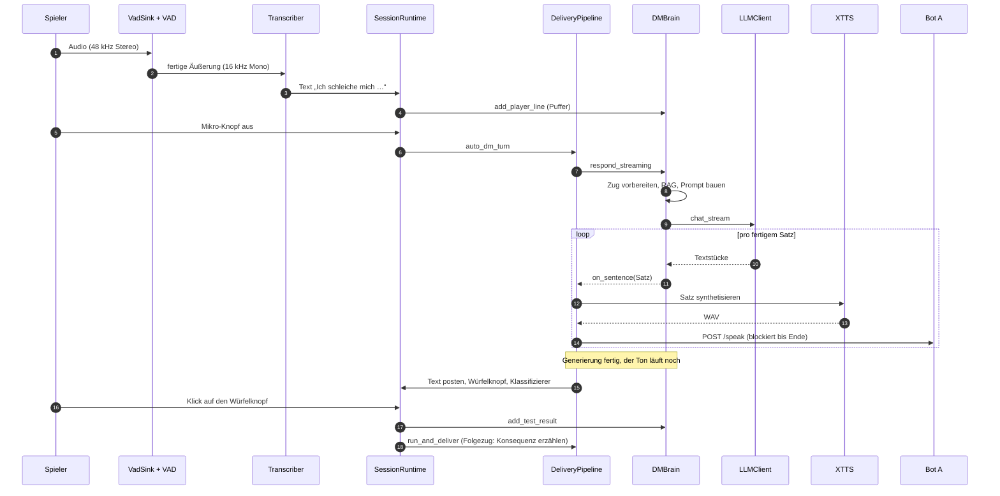
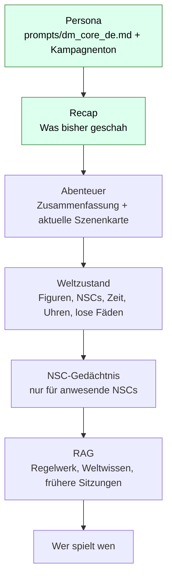
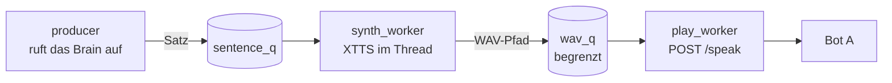

# 2 · Ein Spielzug von A bis Z

Dieses Kapitel verfolgt eine einzige Spieleraktion durch das ganze Programm: vom gesprochenen
Satz bis zur gesprochenen Antwort, einschließlich Würfelwurf. Wenn du diesen einen Weg
verstanden hast, sind alle anderen Befehle Varianten davon.

Das Beispiel: Du spielst Castor, drückst den Mikro-Knopf, sagst „Ich schleiche mich an der
Wache vorbei“ und drückst den Knopf noch einmal.

## Der ganze Weg auf einen Blick



Die Abschnitte unten gehen diese Schritte der Reihe nach durch.

## Vorbedingung: `!join`

`VoiceCog.join` in `voice/voicecog.py` baut die Leitung auf:

1. Mit dem Sprachkanal verbinden (`VoiceRecvClient`, die Empfangs-Erweiterung).
2. Einen `VadSink` erzeugen und ihm zwei Dinge mitgeben: Bot As Benutzer-ID zum Herausfiltern
   und `runtime._on_utterance` als Rückruf für fertige Äußerungen.
3. Den Sink in einen `SilenceGeneratorSink` einwickeln. Grund: Discord schickt keine Pakete,
   solange jemand schweigt. Ohne künstlich eingefügte Stille würde der VAD nie das Ende eines
   Satzes sehen.
4. `seed_session` lädt Charakterbögen, Weltzustand und Abenteuer für diesen Kanal und füllt die
   Prompt-Blöcke des Brains.
5. Anzeigen und Mikro-Knopf posten.

Ab jetzt läuft der Empfang dauerhaft im Hintergrund.

## Schritt 1: Aus Audio wird eine Äußerung

**Konzept: VAD.** „Voice Activity Detection“ beantwortet für jedes kurze Audiostück die
Frage „spricht da gerade jemand?“. Daraus lässt sich ableiten, wo ein Satz anfängt und
aufhört. Das ist nötig, weil Spracherkennung auf abgeschlossenen Stücken arbeitet und nicht
auf einem endlosen Strom.

**Hier.** `voice/recv.py` und `voice/vad.py`, alles auf dem Reader-Thread.

`VadSink` erbt von `PcmLogSink`. Die Elternklasse erledigt pro Audiopaket: Discords
Ende-zu-Ende-Verschlüsselung (DAVE) öffnen, Opus zu rohem PCM dekodieren und Pakete von Bot A
verwerfen. `VadSink._on_pcm` macht dann zwei Dinge:

- **Resampling.** Discord liefert 48 kHz Stereo. VAD und Whisper erwarten 16 kHz Mono. Wird
  das ausgelassen, gibt es keinen Fehler, sondern Unsinn als Transkript. Das ist eine der
  „key gotchas“ in `CLAUDE.md`.
- **Segmentieren.** Pro Spieler gibt es einen eigenen `UtteranceSegmenter`. Er füttert das
  Silero-Modell in Stücken von 512 Samples (32 ms) und bekommt je Stück eine
  Sprech-Wahrscheinlichkeit.

Die Regeln des Segmentierers (Konstanten oben in `vad.py`):

| Regel | Wert | Zweck |
|---|---|---|
| Sprache beginnt | Wahrscheinlichkeit ≥ 0,5 | Start einer Äußerung |
| Stille | Wahrscheinlichkeit < 0,35 | zählt als Pause |
| Äußerung endet | 600 ms Stille am Stück | eine Denkpause mitten im Satz trennt nicht |
| Mindestlänge | 250 ms echte Sprache | Husten und Klicks fallen weg |
| Polster | 200 ms davor und danach | Wortanfänge und -enden werden nicht abgeschnitten |

Die Lücke zwischen 0,5 und 0,35 heißt **Hysterese**: Zum Einschalten braucht es mehr als zum
Ausschalten. Ohne sie würde die Erkennung bei Werten um die Schwelle herum flattern.

Ist eine Äußerung fertig, ruft der Segmentierer `SessionRuntime._on_utterance` auf.

## Schritt 2: Aus der Äußerung wird Text

`SessionRuntime._on_utterance` in `runtime.py` läuft noch auf dem Reader-Thread und tut
deshalb nur das Nötigste:

- Es merkt sich, welche Figur zu diesem Discord-Benutzer gehört. Jetzt ist die Benutzer-ID
  noch bekannt, später kommt nur der Anzeigename zurück.
- Es reicht das Audio an den Transcriber weiter und hängt dabei den Wert `for_dm` an: War
  der Mikro-Knopf in diesem Moment an?

Dieser zweite Punkt ist das Beispiel für „Zustand zum Zeitpunkt des Ereignisses festhalten“
aus Kapitel 1. Whisper braucht einen Moment. Würde erst danach nachgeschaut, ob der Knopf an
ist, wäre er bei deinem letzten Satz schon wieder aus und der Satz ginge verloren.

`Transcriber` in `stt/transcriber.py` ist ein eigener Thread mit einer Warteschlange.
`_transcribe_one` ruft faster-whisper auf, `confident_text` (`stt/segments.py`) wirft
unsichere Stücke und bekannte Whisper-Halluzinationen weg. Bleibt Text übrig, geht er an
`SessionRuntime._on_transcript`.

## Schritt 3: Der Text landet im Puffer

`SessionRuntime._on_transcript`, auf dem STT-Thread:

1. Jede Zeile wird geloggt (`📝 Name | Dauer·ms →DM | Text`), egal ob der Knopf an war. Das
   Protokoll des ganzen Tisches bleibt vollständig.
2. Nur Zeilen mit `for_dm` gehen weiter. Das ist das „Knopf-Fenster“.
3. Der Discord-Name wird durch den Figurennamen ersetzt, damit das Modell Figuren anspricht.
4. `DMBrain.add_player_line` hängt `("Castor", "Ich schleiche mich an der Wache vorbei")` an
   den Puffer des Kanals (hinter dem Lock).
5. Die Zeile wird als `🗣 Castor: …` in den Textkanal gespiegelt.

Wichtig: Bis hier antwortet niemand. Der Bot sammelt nur. Mehrere Spieler können nacheinander
sprechen, alle Zeilen liegen im selben Puffer.

## Schritt 4: Der Auslöser

Es gibt drei Wege, einen Zug zu starten. Alle enden in derselben Pipeline:

| Auslöser | Einstieg | Typ im Log |
|---|---|---|
| Mikro-Knopf aus | `VoiceCog._on_mic_stop` → Hook `auto_dm_turn` → `DeliveryPipeline._auto_dm_turn` | `auto` |
| `!dm` oder `!dm <Text>` | `DMCog.dm` | – |
| Würfelergebnis liegt vor | `DiceCog` → Hook `run_and_deliver` → `DeliveryPipeline._run_and_deliver` | `roll` |

Im Beispiel greift der erste. `_auto_dm_turn` wartet zuerst bis zu vier Sekunden, bis der
Transcriber leer ist (`wait_idle`). Dein letzter Satz steckt beim Loslassen des Knopfs oft
noch in Whisper. Ist der Puffer danach leer, passiert nichts.

Vor dem Knopfdruck selbst passiert noch eine Kleinigkeit in `VoiceCog.toggle_listening`: Die
gerade offene Äußerung wird sofort abgeschnitten (`flush_open`), *bevor* der Schalter
umgelegt wird. So zählt das letzte Wort noch zum Fenster.

## Schritt 5: Den Zug vorbereiten

`DMBrain._respond` in `orchestrator.py` ruft `_prepare_turn`. Diese Funktion macht aus dem
Puffer die eine Nachricht, die das Modell als „User“ sieht:

1. Puffer leeren (`_drain`).
2. Zeilen ohne Buchstaben oder Ziffer wegwerfen (Whisper liefert bei Hintergrundgeräusch
   manchmal „…“).
3. Auf die letzten acht Zeilen kürzen (`DM_MAX_LINES`). Die jüngste Absicht soll zählen und
   nicht das Geplauder davor.
4. Würfelergebnisse und Regie-Notizen aus ihren eigenen Warteschlangen dazunehmen.
5. Alles zu einem Text zusammensetzen, in dieser Reihenfolge:

```
[Würfel] <Ergebniszeile der Engine>      (nur im Folgezug nach einem Wurf)
[Regie] <Notiz, z. B. „Uhr ist voll“>    (nur wenn eine ansteht)
Castor: Ich schleiche mich an der Wache vorbei
```

6. Die **Labels** festlegen: alle Namen am Tisch plus generische Rollen. Damit wird später
   verhindert, dass das Modell für die Spieler weiterspricht (siehe Schritt 7).

Gibt es weder Zeilen noch Ergebnisse, liefert `_prepare_turn` `None` und der Zug entfällt.

## Schritt 6: Der Prompt

Zwei Dinge passieren, bevor das Modell gefragt wird.

**RAG auffrischen.** `_refresh_rag` schickt die Eingabe des Zugs an
`RulebookRetriever.fetch_block` (`rag/retrieve.py`). Der Text wird in einen Vektor
umgewandelt, im Vektorspeicher werden ähnliche Regelwerk- und Lore-Stücke gesucht. In den
Prompt kommen sie nur, wenn sie nah genug sind. Bei den meisten Erzählzügen ist der Block
leer. Dazu können bis zu zwei Stücke aus früher gespielten Sitzungen kommen. Wie das genau
funktioniert, ist Stoff für Kapitel 5.

Ein Zug ohne Spielerzeile, etwa der Folgezug nach einem Würfelwurf, wird nicht
nachgeschlagen: In einer Würfelzeile steckt keine Frage. Die Dauer der Suche steht als `rag=`
in der `[latency]`-Zeile.

**Anfrage bauen.** `_build_request` setzt drei Teile zusammen:

- den **System-Prompt** über `assemble_system_prompt` (`llm/prompt_assembly.py`),
- die **Nachrichten**: bisheriger Verlauf plus die neue User-Nachricht aus Schritt 5,
- die **Optionen**: Längenbegrenzung (`DM_NUM_PREDICT`, Standard 220 Tokens) und die Labels
  als Stopp-Sequenzen.

Die Reihenfolge im System-Prompt ist fest und steht an genau einer Stelle im Code:



Die beiden grünen Blöcke bilden den „stabilen Kopf“ (`SystemPrompt.stable`): Sie bleiben von
Zug zu Zug gleich. Alles darunter ändert sich laufend.

Woher kommen die mittleren Blöcke? Nicht aus dem Brain. Die Runtime baut sie in
`PersistenceMixin._persist_and_refresh` (`session/persistence.py`) jedes Mal neu, wenn sich
der Weltzustand ändert, und drückt sie mit `brain.set_context(...)` ins Brain. Das Brain
liest sie beim Bauen der Anfrage nur aus. Merke: **Zustand ändern heißt immer speichern und
Prompt-Blöcke neu bauen**, deshalb taucht `_persist_and_refresh` an so vielen Stellen auf.

## Schritt 7: Generieren und streamen

**Konzept: Streaming.** Ein Sprachmodell erzeugt Text Stück für Stück. Statt auf die ganze
Antwort zu warten, kann man die Stücke sofort weiterverarbeiten. Hier bedeutet das: Der erste
Satz wird schon gesprochen, während der dritte noch entsteht. Die Wartezeit bis zum ersten
Ton sinkt von „ganze Antwort plus ganze Synthese“ auf „erster Satz“.

**Hier.** `GenerationMixin._stream_once` in `brain/generation.py` ruft
`client.chat_stream(...)` auf und schiebt jedes Textstück in einen `StreamAssembler`
(`llm/stream_assembler.py`). Der Assembler entscheidet, wann ein Satz „sprechreif“ ist. Seine
Zurückhalte-Regeln:

- Der **erste** Satz wird erst freigegeben, wenn er vollständig ist. So lässt sich eine
  Meta-Einleitung („Hier ist meine Antwort:“) noch entfernen, bevor etwas gesprochen wird.
- Der jeweils **letzte** fertige Satz wird zurückgehalten, bis der nächste da ist. So greifen
  die Säuberungen am Ende (angehängtes „Was tut ihr?“, abgeschnittenes Wort) noch.
- Ab einem offenen `<<` wird nichts mehr freigegeben, bis `>>` kommt. Marker werden nie
  gesprochen.
- Taucht mitten im Text ein Sprecher-Label auf (`Castor: …`), wird der Strom abgebrochen.
  Das Modell wollte für einen Spieler sprechen („Puppeteering“). Nur der Text davor bleibt.

Jeder freigegebene Satz geht über `sink.on_sentence(...)` an die DeliveryPipeline.

Am Ende berechnet `StreamAssembler.finish` die endgültige Antwort noch einmal aus dem
gesamten Rohtext, mit derselben Funktion wie im Nicht-Streaming-Pfad (`finalize_answer`). So
steht im Verlauf garantiert derselbe Text, egal welcher Pfad lief. Dabei werden auch die
Marker herausgelesen und in Warteschlangen gelegt (`_queue_markers`).

Um den Aufruf herum liegen Schutzregeln in `_guarded_answer` und `_run_turn`:

- **Echo-Schutz.** Plappert die Antwort nur die Spielerzeile nach oder wiederholt die vorige
  Antwort, wird einmal mit einem Korrekturhinweis neu generiert. Geht das wieder schief, wird
  der Zug unterdrückt und nicht in den Verlauf geschrieben. Das geht nur, solange noch nichts
  gesprochen wurde: Gesprochener Ton lässt sich nicht zurückholen
  (`docs/lessons/spoken-audio-cannot-be-retracted.md`).
- **Verlauf fortschreiben.** `_append_turn` hängt User-Nachricht und Antwort an. Das passiert
  am Ende des Zugs und nicht am Anfang.

## Schritt 8: Sprechen

**Konzept: Erzeuger-Verbraucher mit Warteschlangen.** Wenn mehrere Arbeitsschritte
unterschiedlich schnell sind, verbindet man sie mit Warteschlangen. Jeder Schritt nimmt vorne
etwas heraus und legt hinten etwas ab. Ist eine Warteschlange begrenzt, bremst sie den
Schritt davor automatisch.

**Hier.** `DeliveryPipeline._deliver_streaming` in `voice/delivery.py` startet drei
gleichzeitig laufende Aufgaben:



- Der **producer** ruft `brain.respond_streaming` auf. Das ist Schritt 5 bis 7. Jeder
  sprechreife Satz landet in `sentence_q`.
- Der **synth_worker** nimmt Sätze heraus, wendet die Sprech-Umformung an (je nach
  `!sprechmodus` werden zum Beispiel Satzzeichen entfernt) und lässt XTTS in einem eigenen
  Thread eine WAV-Datei erzeugen.
- Der **play_worker** schickt die Dateien nacheinander über `BridgeClient.speak` an Bot A.
  Dieser Aufruf kehrt erst zurück, wenn die Datei zu Ende gespielt ist. Das blockierende
  Zurückkehren ist das einzige „Fertig“-Signal zwischen den Bots.

`wav_q` ist begrenzt. Dadurch läuft die Synthese der Wiedergabe höchstens einen Satz voraus
(mehr im Modus „puffer“).

Zwei Sperren regeln, was passiert, wenn mehrere Züge kurz hintereinander ausgelöst werden:

- `_narration` (ein `asyncio.Lock`): Es wird immer nur **eine** Erzählung gleichzeitig
  generiert. Die Sperre wird freigegeben, sobald die Generierung fertig ist, also während der
  Ton noch läuft.
- `_speaking`: Antworten werden in der Reihenfolge gesprochen, in der sie generiert wurden,
  und jede ganz zu Ende.

## Schritt 9: Was passiert, während der Ton noch läuft

Sobald der producer fertig ist, kennt die Pipeline die ganze Antwort. Der Ton läuft noch
einige Sekunden. Diese Zeit wird genutzt, weil sie den Tisch nichts kostet:

1. **Text posten.** Die Antwort erscheint im Textkanal.
2. **Würfelknopf.** `runtime.handle_dice` (das ist `DiceCog._handle_dice`) entscheidet, ob
   und wofür gewürfelt wird. Details in Schritt 10.
3. **Marker abarbeiten.** Je eine Aufgabe für `<<ORT>>`, `<<ERLEDIGT>>`, `<<UHR>>`, `<<ZEIT>>`.
4. **Zuggrenze.** `SceneFlowMixin.close_turn` in `session/scenes.py`: Die Spielzeit rückt
   vor, dann laufen drei Klassifizierer gleichzeitig (ein `asyncio.gather`):
   - Szene: Hat die Gruppe den Ort gewechselt?
   - Fakten: Wurde ein Gegenstand übergeben, ein Auftrag angenommen oder ein Versprechen
     gegeben?
   - Anwesenheit: Ist jemand Neues persönlich aufgetaucht?

   Jeder ist ein eigener kleiner LLM-Aufruf mit JSON-Schema (bei Claude also Haiku). Die
   Urteile werden vom Code geprüft und erst dann auf den Weltzustand angewendet. Fällt einer
   aus, ändert sich nichts („fail open“).

Wenn der letzte Satz gespielt ist, läuft der Abschluss (`DMCog._post_deliver`):

- **Autosave.** Der Zug wird als eine Zeile an `data/sessions/<kanal>/history.jsonl`
  angehängt. Diese Datei ist gleichzeitig Absturzsicherung und das Journal, aus dem später
  die Tests für `dm-eval` entstehen.
- **Mikro-Knopf** wieder ganz nach unten setzen.
- **Auto-Recap.** War der Prompt nahe an der Kontextgrenze, wird der Verlauf jetzt zu einem
  Recap zusammengefasst.

## Schritt 10: Der Würfelwurf

„Ich schleiche mich an der Wache vorbei“ verlangt eine Probe. Wer erkennt das?

Es gibt zwei Quellen, und welche gilt, hängt davon ab, wer erzählt hat
(`DiceCog._handle_dice` und `voice/dice/routing.py`):

| Quelle | Wie | Gilt, wenn |
|---|---|---|
| **Marker** | Das Erzählmodell schreibt `<<TEST Heimlichkeit Herausfordernd für Castor>>` in seine Antwort | Claude hat erzählt und der Marker ist gültig (Figur, Fertigkeit und Schwierigkeit existieren) |
| **Roll-Router** | Ein eigener, kleiner Klassifizierer-Aufruf (`classify_test`) liest nur die Spieleraktion und antwortet mit JSON | Ollama hat erzählt, oder Claude hat keinen gültigen Marker geliefert |

Den Router gibt es, weil kleine Modelle unsichere Aktionen gern selbst auflösen („du
schleichst unbemerkt vorbei“), statt eine Probe zu verlangen. Als getrennte, eng gefasste
Frage beantwortet dasselbe Modell das zuverlässig
(`docs/lessons/mandatory-decisions-need-a-separate-classifier.md`).

Egal welche Quelle: Das Modell nennt nur **Wörter** (Fertigkeit, Schwierigkeitsstufe). Die
Zahlen kommen aus dem Code:

```
Zielwert = Fertigkeitswert der Figur (characters.json)
         + Modifikator der Stufe (Schwierigkeitsleiter im Systemprofil)
```

Der Knopf erscheint, während die Spielleitung noch spricht. Beim Klick:

1. Die Engine würfelt und wertet aus (`rules/engine.py`). Das Ergebnis wird gepostet.
2. Bei einem Fehlschlag mit verbleibendem Schicksalspunkt gibt es erst die Frage „Neu würfeln
   oder hinnehmen?“.
3. `DiceCog._finish_roll` legt die Ergebniszeile mit `brain.add_test_result(...)` in die
   Warteschlange. Bei einem gelungenen Angriff läuft vorher noch der Schadensablauf.
4. `_narrate_rolls` ruft den Hook `run_and_deliver`. Stehen im selben Zug noch weitere
   Würfelknöpfe offen, wartet die Erzählung auf sie, damit zwei Spieler eine gemeinsame
   Antwort bekommen.

Damit beginnt ein **Folgezug**. Er läuft durch dieselben Schritte 5 bis 9, mit einem
Unterschied: Es gibt keine Spielerzeile, nur `[Würfel] …`. `_prepare_turn` hängt in diesem
Fall eine ausdrückliche Anweisung an („erzähle die Konsequenz“). Marker für neue Proben
werden in so einem Folgezug verworfen, sonst würde ein Wurf den nächsten auslösen und die
Schleife nie enden.

## Wenn Claude nicht antwortet

Mit `DM_LLM_ON_FAILURE=pause` (dein Standard) wirft der `FailoverClient` einen
`LLMPausedError`, und zwar nur, solange noch kein Textstück angekommen ist. `_respond` fängt
ihn und ruft `_hold_turn`: Die Spielerzeilen, Würfelergebnisse und Notizen des Zugs gehen
zurück in ihre Warteschlangen, als wäre der Zug nie versucht worden. Im Kanal erscheint ein
⏸-Hinweis. Ein Wächter im `DMCog` (`_watch_backend`) fragt in wachsenden Abständen nach und
beantwortet den aufgehobenen Zug selbst, sobald Claude wieder da ist.

## Selbsttest

1. Du lässt den Mikro-Knopf los, während dein letzter Satz noch transkribiert wird. An
   welchen zwei Stellen sorgt der Code dafür, dass der Satz trotzdem im Zug landet?
2. Warum hält der `StreamAssembler` immer den letzten fertigen Satz zurück?
3. Claude schreibt mitten in der Antwort „Castor: Ich ziehe mein Schwert.“ Was passiert, und
   welche zwei Mechanismen greifen?
4. Was ist der Unterschied zwischen `_narration` und `_speaking`, und warum reicht eine
   Sperre allein nicht?
5. Woher kommt die Zahl, gegen die bei „Heimlichkeit, Schwer“ gewürfelt wird? Welchen Anteil
   daran hat das Sprachmodell?
6. Nach einem Würfelwurf schreibt das Modell in der Konsequenz-Erzählung wieder `<<TEST …>>`.
   Was passiert mit diesem Marker und warum?
7. Die drei Klassifizierer an der Zuggrenze brauchen zusammen mehrere Sekunden. Warum merkt
   der Tisch davon nichts?
8. Du änderst per `!damage` die Wunden einer Figur. Welche Funktion sorgt dafür, dass das
   Modell im nächsten Zug den neuen Wert sieht?

<details>
<summary>Antworten</summary>

1. Erstens hält `_on_utterance` den Knopfzustand (`for_dm`) schon beim Schneiden der Äußerung
   fest, und `toggle_listening` schneidet die offene Äußerung ab, bevor der Schalter kippt.
   Zweitens wartet `_auto_dm_turn` mit `wait_idle` bis zu vier Sekunden, bis der Transcriber
   leer ist.
2. Weil manche Säuberungen nur am Ende der Antwort greifen (angehängte Frage, abgeschnittenes
   Wort, Klammerzusatz). Ob ein Satz der letzte ist, weiß man erst, wenn ein weiterer kommt
   oder der Strom endet.
3. Der Text ab dem Label wird verworfen und der Strom abgebrochen. Mechanismus eins: Die
   Labels sind Stopp-Sequenzen in den Optionen (wirkt bei Ollama serverseitig). Mechanismus
   zwei: Der Assembler schneidet selbst am Label (`_cut_at_labels`) und setzt `stopped`. Bei
   Claude gibt es keine serverseitigen Stopp-Sequenzen, dort trägt der zweite allein.
4. `_narration` sorgt dafür, dass nur eine Erzählung gleichzeitig *generiert* wird, und wird
   schon bei Generierungsende freigegeben. `_speaking` sorgt dafür, dass Antworten in
   Generierungsreihenfolge und jeweils ganz *gesprochen* werden. Mit nur einer Sperre über
   beides könnte der nächste Zug erst generieren, wenn der vorige zu Ende gesprochen ist.
5. Fertigkeitswert aus `characters.json` plus Modifikator für „Schwer“ aus der
   Schwierigkeitsleiter des Systemprofils. Das Modell liefert nur die beiden Wörter.
6. Er wird aus dem Text entfernt und verworfen. In einem Zug ohne Spieleraktion
   (`last_action` ist `None`) reiht `_queue_markers` keine Proben ein, damit ein Wurf nicht
   endlos neue Würfe auslöst.
7. Sie starten bei Generierungsende und laufen, während die Antwort noch abgespielt wird.
8. `_persist_and_refresh`: Sie speichert den State und baut die Prompt-Blöcke neu
   (`brain.set_context`).

</details>

Zurück zu [Kapitel 1](01-ueberblick.md) · [Inhaltsverzeichnis](README.md)
