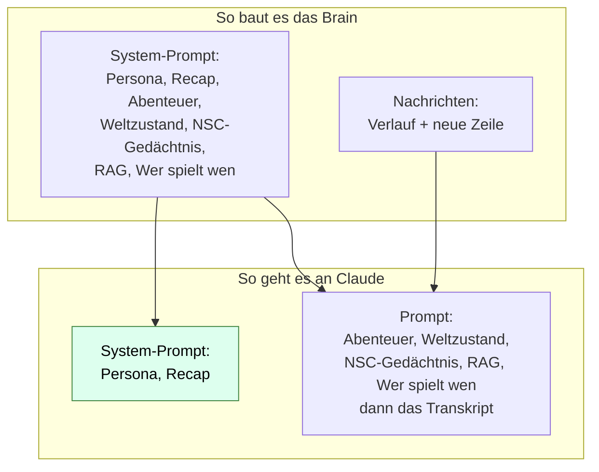

# 3 · Der Prompt: was Claude pro Zug zu sehen bekommt

Ein Sprachmodell weiß nur, was in der einen Anfrage steht, die es gerade bekommt. Alles, was
die Spielleitung „weiß“ (wer am Tisch sitzt, wo die Gruppe ist, was letzte Woche geschah),
muss bei jedem Zug neu mitgeschickt werden. Dieses Kapitel zeigt, woraus diese Anfrage
besteht, wer welchen Teil baut und was passiert, wenn sie zu groß wird.

## Konzept: System-Prompt, Verlauf, Kontextfenster

Eine Anfrage an ein Chat-Modell hat zwei Teile:

- den **System-Prompt**: Anweisungen und Hintergrundwissen, die für die ganze Unterhaltung
  gelten („Du bist die Spielleitung …“),
- die **Nachrichten**: der bisherige Wechsel aus Spieler- und Spielleiter-Beiträgen, am Ende
  die neue Spielerzeile.

Beides zusammen muss ins **Kontextfenster** passen. Das ist die Höchstmenge an Text, die das
Modell auf einmal verarbeiten kann, gemessen in Tokens (grob: Wortstücke). Wird es zu viel,
schneidet ein lokales Modell wie Nemo vorne ab, und vorne steht die Persona. Deshalb gilt:
Jeder Block im Prompt kostet Platz und muss sich lohnen.

Eine zweite Kostenfrage ist der **Prompt-Cache**. Wenn der Anfang einer Anfrage Byte für Byte
derselbe ist wie bei einer früheren, kann der Anbieter die Vorarbeit wiederverwenden. Das
spart Zeit und Kontingent. Daraus folgt eine Bauregel: Was sich nie ändert, gehört nach
vorne. Was sich jeden Zug ändert, nach hinten.

## Die sieben Blöcke des System-Prompts

Die Reihenfolge steht an genau einer Stelle: `assemble_system_prompt` in
`dmbot/llm/prompt_assembly.py`. Die Funktion rechnet nichts, sie fügt nur zusammen. Leere
Blöcke fallen weg.

| Nr. | Block | Gebaut von | Ändert sich |
|---|---|---|---|
| 1 | Persona | `load_system_prompt` (`llm/persona.py`) | nie, außer du editierst die Datei |
| 2 | Recap | `DMBrain.summarize`, gespeichert im State | bei `!wrap` und beim Auto-Recap |
| 3 | Abenteuer | `Adventure.adventure_block_de` (`rag/adventure.py`) | bei Szenenwechsel und abgehakten Elementen |
| 4 | Weltzustand | `world_state_summary_de` (`memory/state_text.py`) | bei jeder Zustandsänderung |
| 5 | NSC-Gedächtnis | `npc_memory_block_de` (`memory/npc_memory.py`) | bei Szenenwechsel |
| 6 | RAG | `RulebookRetriever.fetch_block` (`rag/retrieve.py`) | jeden Zug mit Spielerzeile |
| 7 | Wer spielt wen | `CharacterStore.alias_hint_de` (`rules/characters.py`) | beim `!join` |

### 1 · Persona

Zwei Dateien, hintereinander gehängt:

- `prompts/dm_core_de.md` (rund 20.000 Zeichen): die generische Spielleiter-Persona. Ihre
  Abschnitte: Haltung, worauf du reagierst, Erzählweise („wird vorgelesen!“), NSCs,
  Spielregeln des Zusammenspiels. Hier stehen auch die Marker-Regeln, also wann das Modell
  `<<TEST …>>` schreiben soll.
- `prompts/campaign_tone_de.md`: der Ton der Kampagne (Eisenhorn-Grimdark).

Die Dateien werden bei **jedem Zug frisch gelesen**. Du kannst die Persona also während einer
laufenden Sitzung ändern, und der nächste Zug nutzt sie schon.

Eine neue Kampagne in einem anderen Setting tauscht nur die zweite Datei und das Systemprofil
aus. Der Kern bleibt.

### 2 · Recap

Die Zusammenfassung „Was bisher geschah“. Sie steht im State (`state.recap`) und überlebt so
einen Neustart. Im Prompt bekommt sie die Überschrift „den Spielenden bereits bekannt, nicht
erneut ausführlich erzählen“, sonst erzählt das Modell sie gern nach.

Persona und Recap bilden zusammen den **stabilen Kopf**. Mehr dazu unten beim Cache.

### 3 · Abenteuer

Zwei Teile:

- die **Zusammenfassung** des ganzen Abenteuers (rund 300 Tokens), immer dabei, mit dem
  Vermerk „niemals wörtlich vorlesen“,
- die **eine aktuelle Szenenkarte**: Beschreibung, anwesende NSCs, „Möglichkeiten hier“,
  „Bereits geschehen“, „Geheimnisse (NIE aussprechen)“, „Bekannt“, Ausgänge.

Die Karte ist zustandsabhängig. Ein abgehaktes Element wandert von „Möglichkeiten hier“ nach
„Bereits geschehen“, ein getöteter NSC bekommt `(tot)`. Jedes Element trägt eine ID wie
`[opp-1]`, damit das Modell sie in `<<ERLEDIGT opp-1>>` nennen kann.

Die **Regie-Hinweise** der Karte stehen nicht in jedem Zug drin. Ständig wiederholte Hinweise
werden zur Floskel, die das Modell dauernd aufsagt. `_guidance_due` in
`session/persistence.py` lässt sie nur im ersten Zug einer Szene und dann in jedem n-ten Zug
durch (`DM_GUIDANCE_EVERY`).

Warum nur *eine* Karte und nicht das ganze Abenteuer? Erstens Platz. Zweitens Spoiler: Was
nicht im Prompt steht, kann das Modell nicht ausplaudern.

### 4 · Weltzustand

Die harten Fakten als Stichpunktzeilen, bewusst keine Prosa. Überschrift: „harte Fakten,
verlass dich darauf, erfinde keine abweichenden Werte“. Die Zeilen, soweit vorhanden:

```
Ort: …
Zeit: Tag 2, 14:30 (Tag)
Fristen: …
Gruppe: Castor 8/11 (verwundet); Mortn 9/9
Ausrüstung: Castor: Laspistole, Dietrichset; …
NSCs in der Szene: …
NSCs anderswo (NICHT anwesend …): …
Agenden: …
Mission / Offene Aufträge: …
Übergeben: …
Zusagen: …
Uhren: Arbites-Ermittlung ◉◉◉○○○
```

Zwei Zeilen verdienen eine Erklärung:

- **„NSCs anderswo“.** Früher gab es nur eine NSC-Liste. Dann ließ das Modell den Seneschall
  aus Szene eins in Szene vier mitreden, weil er „in der Liste stand“. Jetzt wird
  ausdrücklich getrennt, wer hier ist und wer nicht.
- **„Übergeben“ und „Zusagen“.** Wenn ein NSC der Gruppe in Zug 7 eine Vollmacht gibt, steht
  das nur im Verlauf. Der Verlauf wird irgendwann gekürzt oder zusammengefasst, und in Zug 16
  verweigert derselbe NSC die Vollmacht. Deshalb schreibt der Fakten-Klassifizierer solche
  Dinge als harte Fakten in den State.

An diesen Block hängt `_persist_and_refresh` noch weitere an: einen kompakten Auszug der
Charakterbögen, den Psioniker-Block, Augmentationen und die drei wichtigsten „losen Fäden“.

### 5 · NSC-Gedächtnis

Nur für NSCs, die gerade in der Szene sind: die wichtigsten Erinnerungen jedes NSCs (Standard
über `DM_NPC_MEMORY_TOP_K`). Details in Kapitel 5.

### 6 · RAG

Der einzige Block, der pro Zug frisch gesucht wird (bei Zügen ohne Spielerzeile entfällt
die Suche, der Block ist dann leer). Meist leer. Wenn nicht, in dieser
Reihenfolge: `## Regelwerk`, `## Weltwissen`, `## Früher in der Kampagne`. Details in
Kapitel 5.

### 7 · Wer spielt wen

Eine kurze Zuordnung von Spielern zu Figuren samt Spitznamen, damit das Modell „Tobi“ und
„Castor“ zusammenbringt.

## Die Nachrichten: Verlauf plus neue Zeile

Der Verlauf ist eine einfache Liste im Brain (`ChannelSession.history`): abwechselnd
`{"role": "user", …}` und `{"role": "assistant", …}`. `_append_turn` hängt nach jedem Zug ein
Paar an und schneidet vorne ab, sobald mehr als 20 Züge drin sind (`max_history_turns`).

Was als „user“ gespeichert wird, ist genau der Text aus Kapitel 2, Schritt 5:

```
[Würfel] 🎲 Castor auf Heimlichkeit (Ziel 45): 23 — Erfolg, 2 EG.
[Regie] …
Castor: Ich schleiche mich an der Wache vorbei
```

Die drei Präfixe haben feste Bedeutungen: `Name:` ist
eine Spielerzeile, `[Würfel]` ein Ergebnis der Engine, `[Regie]` eine Anweisung des Codes an
das Modell (zum Beispiel „die Uhr ist voll, die Konsequenz tritt jetzt ein“).

## Wie Claude die Anfrage bekommt

Ollama bekommt System-Prompt und Nachrichtenliste getrennt. Bei Claude läuft es anders, weil
der Bot die Claude-CLI über dein Abo steuert und jeder Aufruf für sich steht.
`dmbot/llm/claude_client.py` macht zwei Umformungen:

**Der Verlauf wird zu einem Transkript.** `render_transcript` schreibt die Nachrichtenliste
als einen Text:

```
Setze die Sitzung fort; antworte nur als Spielleitung.

Spieler: Castor: Ich sehe mich um
Spielleitung: Der Korridor liegt im Halbdunkel …
Spieler: Castor: Ich schleiche mich an der Wache vorbei
```

Die Labels heißen absichtlich `Spieler:` und `Spielleitung:`. Genau diese Wörter kennen die
Schutzfilter. Fängt Claude seine Antwort mit „Spielleitung:“ an oder schreibt selbst eine
„Spieler: …“-Zeile weiter, wird das abgeschnitten.

**Der System-Prompt wird geteilt.** `split_system` schickt nur den stabilen Kopf (Persona und
Recap) als System-Prompt. Der wechselnde Rest (Szenenkarte, Weltzustand, RAG) wandert in
derselben Reihenfolge vor das Transkript.



Der Grund ist der Cache. Die CLI versieht den System-Prompt als **einen** Block mit einer
Cache-Marke. Der Cache trifft nur, wenn der ganze Block identisch ist. Solange Szenenkarte und
Weltzustand mit im System-Prompt standen, war er bei jedem Zug anders und der Cache traf nie.
Mit der Teilung bleibt der grüne Block über viele Züge gleich
(`docs/lessons/cli-caches-the-system-prompt-as-one-block.md`).

## Die Klassifizierer bekommen einen eigenen, winzigen Prompt

Roll-Router, Szenen-, Fakten- und Anwesenheits-Klassifizierer sowie die Extraktoren sehen
**nichts** vom großen Prompt. Jeder bekommt einen eigenen kurzen System-Prompt, eine einzige
User-Nachricht und ein JSON-Schema für die Antwort. Beispiel Roll-Router
(`llm/roll_router.py`): Er sieht die Liste der Fertigkeiten der handelnden Figur, die
Schwierigkeitsstufen und die Zeile `Spieler-Handlung: …`. Mehr nicht.

Das hat zwei Vorteile. Die Aufrufe sind schnell und billig. Und ihr JSON landet nie im
Verlauf, bläht also den Erzähl-Kontext nicht auf.

## Wenn der Kontext eng wird: Auto-Recap

Nach jedem Zug prüft `DMCog._maybe_compact`, ob der Prompt dieses Zugs mehr als 85 % des
Kontextfensters gefüllt hat (`_TurnTiming.ctx_over_budget`). Wenn ja:

1. `DMBrain.summarize` fasst den bisherigen Recap **plus** den laufenden Verlauf zu einem
   neuen Recap zusammen. Der neue ersetzt den alten.
2. Der neue Recap wird im State gespeichert.
3. Erst danach wird der Verlauf im Brain geleert.
4. Ins Journal kommt ein `{"kind": "compact"}`-Ereignis, damit ein Neustart die
   zusammengefassten Züge nicht noch einmal oben auf den Recap lädt.
5. Im Textkanal erscheint ein kurzer Hinweis.

Das läuft **nach** der Wiedergabe, kostet also keine Wartezeit im Zug. Die Reihenfolge
„erst speichern, dann leeren“ ist Absicht: Schlägt die Zusammenfassung fehl, bleibt der
Verlauf, wie er war.

Bei Claude ist das Kontextfenster viel größer als bei Nemo. Der Bot rechnet trotzdem mit
einem nominellen Budget (`CLAUDE_NUM_CTX`), damit der Auto-Recap im selben Takt läuft und der
Prompt nicht unbemerkt wächst.

## Selbsttest

1. Du änderst mitten in der Sitzung einen Satz in `prompts/dm_core_de.md`. Ab wann wirkt das,
   und was kostet es bei Claude einmalig?
2. Warum stehen Szenenkarte und Weltzustand bei Claude nicht im System-Prompt, obwohl
   `assemble_system_prompt` sie dort einsortiert?
3. Das Modell lässt einen NSC sprechen, der in einer früheren Szene zurückblieb. Welche Zeile
   im Weltzustand soll das verhindern?
4. Warum sieht der Roll-Router den Gesprächsverlauf nicht?
5. In welcher Reihenfolge laufen beim Auto-Recap „Verlauf leeren“ und „Recap speichern“, und
   warum?
6. Wozu dienen die IDs wie `[opp-1]` in der Szenenkarte?

<details>
<summary>Antworten</summary>

1. Ab dem nächsten Zug, weil `load_system_prompt` die Dateien jedes Mal frisch liest. Der
   stabile Kopf ist danach einmal anders, der Cache trifft bei diesem einen Zug nicht.
2. Weil die CLI den System-Prompt als einen Cache-Block behandelt. `split_system` schickt
   deshalb nur den stabilen Kopf als System-Prompt und stellt den Rest vor das Transkript.
3. „NSCs anderswo (NICHT anwesend, sie sprechen und handeln in dieser Szene nicht)“.
4. Er soll eine eng gefasste Frage zuverlässig beantworten. Der Verlauf würde ihn langsamer
   und teurer machen und zum Erzählen verleiten. Außerdem bleibt sein JSON so aus dem
   Erzähl-Kontext heraus.
5. Erst Recap speichern, dann Verlauf leeren. Geht beim Zusammenfassen etwas schief, ist
   nichts verloren.
6. Das Modell kann sie in `<<ERLEDIGT id>>` nennen, und der Code kann prüfen, ob es das
   Element wirklich gibt, bevor er es abhakt.

</details>

Weiter mit [Kapitel 4: Würfel und Regeln](04-wuerfel-und-regeln.md).
