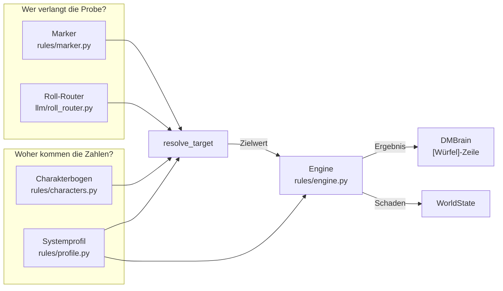
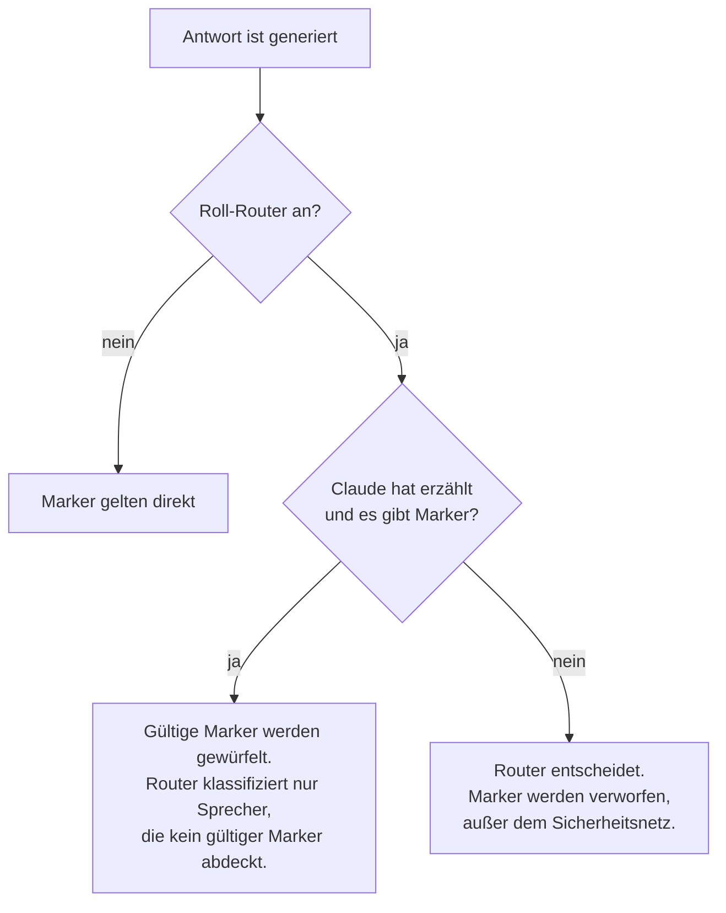

# 4 · Würfel und Regeln: Router, Marker, Engine, Profil

„Dice = code, narration = LLM“ ist die Regel, an der das Projekt am strengsten festhält. Das
Sprachmodell würfelt nie und rechnet nie. Dieses Kapitel zeigt, wie aus „Ich schleiche mich
vorbei“ ein ausgewerteter Wurf wird und welche vier Bausteine daran beteiligt sind.

## Konzept: Daten von Logik trennen

Ein Regelsystem hat zwei Seiten. Die **Mechanik** ist allgemein: „würfle, vergleiche mit
einem Zielwert, zähle Erfolgsgrade“. Die **Zahlen** sind systemspezifisch: welcher Würfel,
welche Schwierigkeitsstufen, welche Waffen.

Schreibt man beides in denselben Code, braucht jedes neue Regelwerk neuen Code. Trennt man es,
bleibt der Code gleich und nur eine Datei mit Zahlen wird ausgetauscht. Das ist hier die
**Engine** (Code) und das **Systemprofil** (JSON).

## Die vier Bausteine



### 1 · Das Systemprofil

`data/systems/imperium_maledictum.json`, geladen von `rules/profile.py` als `SystemProfile`.
Die wichtigsten Einträge:

```jsonc
{
  "dice": "1d100",
  "resolution": "roll_under",       // Erfolg, wenn Wurf ≤ Zielwert
  "degrees": "tens_difference",     // Erfolgsgrade = Zehnerstelle Ziel − Zehnerstelle Wurf
  "difficulty_ladder": {
    "Sehr leicht": 60, "Leicht": 40, "Routine": 20, "Herausfordernd": 0,
    "Schwierig": -10, "Schwer": -20, "Sehr schwer": -30
  },
  "default_difficulty": "Herausfordernd",
  "crit": "doubles",                // Pasch = kritisch …
  "crit_scope": "attack",           // … aber nur bei Angriffswürfen
  "auto_success_max": 5,            // 01–05 gelingt immer
  "auto_fail_min": 96,              // 96–00 misslingt immer
  "combat":    { "attack_skills": …, "weapons": …, "soak": … },
  "psyker":    { … },
  "fate":      { … },
  "augmetics": { … }
}
```

Blöcke wie `combat`, `psyker` oder `fate` sind optional. Fehlt einer, gibt es dieses Feature
für das System einfach nicht. `profile.combat_enabled()` und Verwandte fragen das ab.

### 2 · Der Charakterbogen

`data/sessions/<kanal>/characters.json`, geladen als `CharacterStore`. Wird **nur gelesen**.
`store.get("Castor")` findet eine Figur über Namen oder Alias, `store.skill_value(figur,
"Heimlichkeit")` liefert den Wert.

Alles Veränderliche (aktuelle Wunden, Zustände, Inventar) steht nicht hier, sondern im
`WorldState`. So bleibt der Bogen so, wie du ihn von Hand angelegt hast.

### 3 · Wer die Probe verlangt

**Der Marker.** Das Erzählmodell schreibt in seine Antwort:

```
<<TEST Heimlichkeit Herausfordernd für Castor>>
```

`rules/marker.py` findet solche Marker per Regex, entfernt sie aus dem gesprochenen Text und
macht daraus ein `TestRequest` (Fertigkeit, Schwierigkeit, Figur). Die Erkennung ist
absichtlich tolerant gegenüber Schreibfehlern des Modells (`<<TEST:…>>`, fehlende
Leerzeichen). Alle Marker-Arten sind in einer Liste registriert (`MARKER_SPECS`), sodass ein
neuer Marker an einer Stelle dazukommt.

**Der Roll-Router.** `DMBrain.classify_test` in `brain/side_calls.py` stellt einem Modell eine
einzige, eng gefasste Frage: „Braucht diese Spieler-Handlung eine Probe, und wenn ja, welche
Fertigkeit und welche Schwierigkeit?“ Die Antwort ist durch ein JSON-Schema erzwungen:

```json
{ "needs_test": true, "skill": "Heimlichkeit", "difficulty": "Herausfordernd" }
```

`skill` darf nur ein Wert aus der Fertigkeitenliste der handelnden Figur sein, `difficulty`
nur eine Stufe aus dem Profil. Das Modell kann also keine Fertigkeit erfinden, die es nicht
gibt.

**Wer gewinnt?** `DiceCog._handle_dice` entscheidet nach dem Erzähler des Zugs:



Der Hintergrund dieser Fallunterscheidung:

- Nemo hat als Erzähler gern die falsche Fertigkeit genannt (live gesehen: Heimlichkeit für
  einen Angriff) oder die Aktion gleich selbst aufgelöst. Deshalb gewinnt bei Ollama der
  Router.
- Claude setzt Marker zuverlässig. Deshalb gilt dort der Marker, sofern er **gültig** ist:
  Figur steht auf dem Bogen, Fertigkeit steht auf diesem Bogen, Schwierigkeit steht auf der
  Leiter (`RollRoutingMixin._check_marker`).
- **Sicherheitsnetz:** Verlangt das Erzählmodell in zwei Zügen hintereinander dieselbe Probe
  für dieselbe Figur und es wurde dazwischen nicht gewürfelt, gilt der Marker auf jeden Fall
  (`MarkerRepeats`). Sonst hängt die Erzählung in einem Moment fest, der auf einen Wurf
  wartet.

### 4 · Die Engine

`rules/engine.py` ist reines Python ohne Abhängigkeit auf Discord, LLM oder Charaktere. Jede
Funktion nimmt einen expliziten Zufallsgenerator (`rng`). Tests geben einen mit festem
Startwert hinein und können exakte Ergebnisse prüfen.

`resolve_test(profile, target)` schlägt in der Tabelle `RESOLVERS` nach, welche Funktion zur
`resolution` des Profils gehört. Für Imperium Maledictum ist das `resolve_roll_under`:

1. W100 würfeln.
2. Erfolg, wenn Wurf ≤ Zielwert.
3. Die Auto-Bänder am Rand übersteuern das: 01–05 gelingt immer, 96–00 misslingt immer,
   jeweils mit 0 Erfolgsgraden.
4. Erfolgsgrade: Zehnerstelle des Zielwerts minus Zehnerstelle des Wurfs.
5. Pasch (11, 22, … 00): bei Erfolg kritisch, bei Fehlschlag Patzer. `scope_doubles` nimmt
   das wieder weg, wenn das Profil Paschs für diese Fertigkeit nicht zählt. Bei Imperium
   Maledictum zählen sie nur für Angriffe.

Ein anderes System (W20 gegen Schwierigkeitsgrad, 2W6 plus Bonus) wäre eine weitere Funktion
in `RESOLVERS` und ein weiteres Profil. Mehr müsste sich nicht ändern.

## Ein Wurf durchgerechnet

Castor hat Heimlichkeit 45. Verlangt ist „Herausfordernd“.

| Schritt | Wo | Ergebnis |
|---|---|---|
| Fertigkeitswert | `CharacterStore.skill_value` | 45 |
| Modifikator | `SystemProfile.difficulty_modifier("Herausfordernd")` | 0 |
| Zielwert | `resolve_target` (`rules/characters.py`) | 45 |
| Wurf | `resolve_roll_under` | 23 |
| Erfolg? | 23 ≤ 45 | ja |
| Erfolgsgrade | 4 − 2 | 2 |
| Ergebniszeile | `describe_result_de` | `🎲 Castor auf Heimlichkeit, Herausfordernd (Ziel 45): 23 — Erfolg, 2 EG.` |

Wäre die Probe „Schwer“ gewesen, läge der Zielwert bei 25 und derselbe Wurf ergäbe
0 Erfolgsgrade (2 − 2). Das Modell hat in beiden Fällen nur das Wort gewählt.

Die Ergebniszeile geht über `brain.add_test_result` in die Warteschlange und erscheint im
nächsten Zug als `[Würfel] …` vor dem Modell (Kapitel 2, Schritt 10).

## Kampf

`rules/combat.py` und `voice/dice/damage.py`. Ein gelungener Wurf auf eine **Angriffs-
fertigkeit** (laut `combat.attack_skills` im Profil) löst den Schadensablauf aus, bevor die
Spielleitung erzählt:

1. **Ziel bestimmen** (`choose_attack_target`). Hat der Angreifer in seiner eigenen Zeile
   genau einen anwesenden NSC genannt, ist der das Ziel. Sonst erscheint eine Auswahl im
   Textkanal, genannte NSCs oben, die eigene Gruppe unten. NSCs in anderen Szenen stehen nie
   zur Wahl.
2. **Schaden würfeln** (`roll_damage`) nach der Waffentabelle des Profils.
3. **Verrechnen** (`resolve_damage`):

```
verlorene Wunden = Waffenschaden + Erfolgsgrade − Schutz   (nie unter 0)
```

   „Schutz“ ist bei Imperium Maledictum nur die Rüstung des Ziels. Das steht als
   `combat.soak` im Profil, ein anderes System kann dort eine Eigenschaft eintragen.

4. **Buchen** (`WorldState.apply_damage`), speichern, Prompt-Blöcke neu bauen.
5. Die Ergebniszeile mit dem Schaden geht an die Spielleitung, die jetzt die Konsequenz
   erzählt.

`!npc add` registriert einen Gegner mit seinen Werten aus dem Abenteuer. `!damage` und `!heal`
sind Handkorrekturen für dich als menschliche Spielleitung.

## Schicksalspunkte, Psikräfte

Zwei Erweiterungen laufen über denselben Weg:

- **Schicksal.** Nach einem Fehlschlag einer Figur mit übrigem Schicksalspunkt fragt der Bot
  „🙏 Neu würfeln“ oder „Hinnehmen“, bevor erzählt wird. Der zweite Wurf gilt.
- **Psikräfte.** `<<MANIFEST Smite für Mortn>>` erzeugt einen eigenen Knopf. Die Engine
  würfelt die Manifestation (`resolve_manifest`), führt die Warp-Ladung im State mit und
  schlägt bei Bedarf in den Tabellen für Phänomene und Gefahren nach (`resolve_perils`,
  `resolve_phenomena`). Macht eine Kraft sofort Schaden, wird er wie ein Waffentreffer
  gebucht.

## Mehrere Würfe in einem Zug

Handeln zwei Spieler im selben Zug, entstehen zwei Knöpfe. `OpenRolls` in `llm/roll_router.py`
zählt, wie viele noch offen sind. `DiceCog._narrate_rolls` erzählt erst, wenn der letzte Wurf
da ist. Würfelt jemand gar nicht, wartet die Erzählung höchstens
`DM_ROLL_BATCH_WAIT_SECONDS`. So bekommen beide Spieler eine gemeinsame Antwort statt zweier
halber.

## Selbsttest

1. Das Modell schreibt `<<TEST Schwertkampf Schwer für Castor>>`, aber Castor hat keine
   Fertigkeit „Schwertkampf“. Was passiert auf einem Claude-Zug?
2. Was müsstest du tun, um ein W20-System zu unterstützen?
3. Warum nimmt jede Engine-Funktion einen `rng`-Parameter?
4. Castor hat Wahrnehmung 38 und würfelt bei „Routine“ eine 55. Erfolg? Wie viele
   Erfolgsgrade?
5. Warum gewinnt bei Ollama der Router und bei Claude der Marker?
6. Der Charakterbogen sagt 11 Wunden, im Spiel hat Castor noch 8. Wo steht die 8, und warum
   nicht im Bogen?

<details>
<summary>Antworten</summary>

1. `_check_marker` stuft den Marker als ungültig ein. Er wird verworfen, und der Roll-Router
   klassifiziert Castors Handlung selbst. Da das Schema nur Fertigkeiten von Castors Bogen
   zulässt, kommt eine gültige Fertigkeit heraus.
2. Ein neues Profil in `data/systems/` anlegen und eine Auswertungsfunktion für
   `"resolution": "roll_over"` in `RESOLVERS` eintragen. Cogs, Brain und Marker bleiben.
3. Damit Tests einen Generator mit festem Startwert übergeben und exakte Ergebnisse prüfen
   können. Ohne das wären Würfeltests Zufall.
4. Zielwert 38 + 20 = 58. 55 ≤ 58, also Erfolg. Erfolgsgrade 5 − 5 = 0. Die 55 ist zwar ein
   Pasch, aber kein kritischer Erfolg: Paschs zählen laut `crit_scope` nur bei Angriffen.
5. Nemo wählte als Erzähler unzuverlässige Fertigkeiten oder löste Aktionen selbst auf; die
   getrennte Klassifizierung war verlässlicher. Claude setzt die Marker zuverlässig und kennt
   beim Erzählen die Lage besser als ein Router, der nur die Spielerzeile sieht.
6. In `state.json` (`WorldState`). Der Bogen ist die von Hand angelegte Quelle und wird nie
   vom Code überschrieben; so lässt sich eine Sitzung durch Löschen von `state.json`
   zurücksetzen.

</details>

Weiter mit [Kapitel 5: Gedächtnis](05-gedaechtnis.md).
