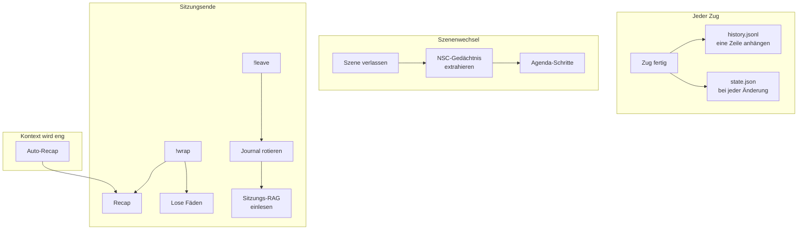
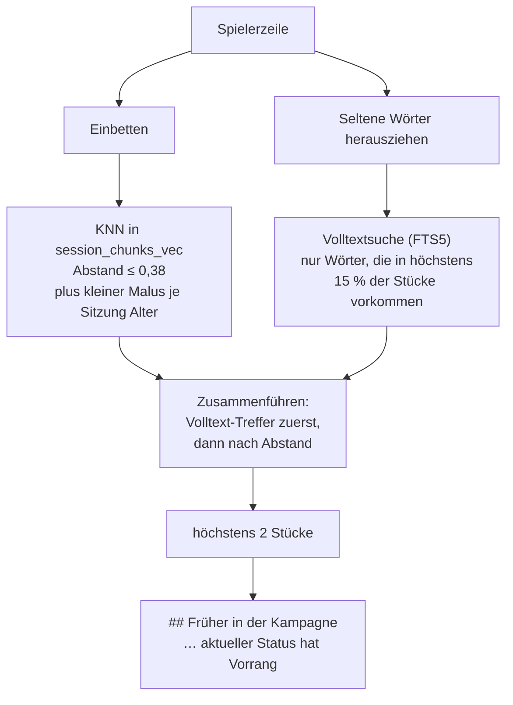

# 5 · Gedächtnis: was der Bot sich merkt und wie

Claude vergisst zwischen zwei Aufrufen alles. Der Bot soll sich trotzdem über Wochen erinnern.
Dieses Kapitel zeigt die sechs Speicher, die das leisten, und warum es sechs sind und nicht
einer.

## Konzept: Warum nicht einfach alles in den Prompt?

Drei Gründe sprechen dagegen:

1. **Platz.** Eine Kampagne über viele Abende passt in kein Kontextfenster.
2. **Verlässlichkeit.** Ein Sprachmodell „liest“ Zahlen aus einem langen Text unzuverlässig.
   Steht irgendwo in Zug 12 „Castor verliert 3 Wunden“, weiß es in Zug 40 nicht mehr sicher,
   wie viele Castor noch hat.
3. **Unterschiedliche Fragen.** „Wie viele Wunden hat Castor?“ ist eine andere Art Frage als
   „Was hat der Händler vor drei Wochen wörtlich gesagt?“. Die erste braucht einen exakten
   Wert, die zweite eine Suche.

Daraus folgt die Grundregel des Projekts („golden rule #3“): **Harte Fakten gehören dem
Code, die Erzählung gehört dem Modell.** Nie wird ein harter Wert aus freiem Modelltext
übernommen.

## Die sechs Speicher im Überblick

| Speicher | Beantwortet | Wer schreibt | Datei |
|---|---|---|---|
| Weltzustand | Was *ist*? | nur Code | `state.json` |
| Verlauf und Journal | Was wurde in dieser Sitzung gesagt? | Code, nach jedem Zug | `history.jsonl` |
| Recap | Was *war* bisher? | Modell fasst zusammen, Code speichert | in `state.json` |
| NSC-Gedächtnis | Was *glaubt* jeder NSC? | Modell schlägt vor, Code prüft | in `state.json` |
| Lose Fäden | Was ist die Geschichte noch *schuldig*? | Modell schlägt vor, Code verwaltet | `chekhov.json` |
| Sitzungs-RAG | Was wurde vor Wochen *wörtlich* gesagt? | Code, beim `!leave` | `data/vectordb/rag.db` |

Alle Dateien außer der letzten liegen in `data/sessions/<kanal>/`.



## 1 · Weltzustand: `WorldState`

`dmbot/memory/state.py`, die Datensätze in `memory/records.py`. Eine Instanz pro Kanal.

Inhalt: Wunden, Zustände und Inventar jeder Figur, die NSCs im Spiel, Aufträge und die
Mission, übergebene Gegenstände und Zusagen (`Fact`), der Ort, die aktuelle Szene
(`scene_id`), abgehakte Szenenelemente (`scene_flags`), die Spielzeit, Fristen, Uhren, der
Recap.

Die Klasse hat für jede erlaubte Änderung eine eigene Methode: `apply_damage`, `heal`,
`tick_clock`, `advance_time`, `place_npc`, `mark_resolved`, `spend_fate` und so weiter. Diese
Methoden prüfen und begrenzen ihre Eingaben selbst. Es gibt keinen Weg, „einfach ein Feld zu
setzen“. Das ist die Stelle, an der „nur Code schreibt“ technisch durchgesetzt wird.

**Bogen und Zustand sind getrennt.** `characters.json` ist die von Hand angelegte Quelle und
wird nie überschrieben. Beim ersten `!join` wird der State einmal daraus befüllt
(`seed_from_store`), danach lebt er eigenständig. Eine Sitzung zurücksetzen heißt:
`state.json` löschen.

**Gespeichert wird bei jeder Änderung**, nicht am Ende. Das Schreiben ist atomar: erst in
eine temporäre Datei, dann mit `os.replace` an die richtige Stelle. Stürzt der Bot mitten im
Schreiben ab, ist die alte Datei noch ganz.

### Spielzeit

Die Zeit ist eine einzige Zahl: `time_minutes`, Minuten seit Tag 1, 00:00. Alles andere wird
daraus berechnet (`memory/gametime.py`): „Tag 2, 14:30“ und die Tagesphase (Morgen, Tag,
Abend, Nacht). Jeder Zug kostet ein paar Minuten, ein Szenenwechsel mehr
(`DM_TURN_TIME_ADVANCE`, `DM_SCENE_TIME_ADVANCE`). Das Modell kann über `<<ZEIT +2h>>` mehr
erbitten.

Eine Zahl statt eines Textes zu speichern, hat einen praktischen Grund: Mit einer Zahl lässt
sich rechnen. Fristen sind einfach „fällig bei Minute 3750“, und ob eine verstrichen ist,
ist ein Vergleich.

### Uhren und Fristen

Beides erzeugt Druck, den das Modell nicht „vergessen“ kann, weil der Code ihn führt:

- **Uhren** (`Clock`) haben 4, 6 oder 8 Segmente. Du legst sie an (`!uhr neu`), das Modell
  darf über `<<UHR id>>` höchstens ein Segment pro Zug erbitten. Ist eine Uhr voll, reiht der
  Code eine `[Regie]`-Notiz für den nächsten Zug ein: Die Konsequenz tritt jetzt ein.
- **Fristen** (`Deadline`) legst nur du an. Läuft eine ab, passiert dasselbe, genau einmal.

## 2 · Verlauf und Journal: `history.jsonl`

`dmbot/memory/history.py`. Der Gesprächsverlauf lebt im Arbeitsspeicher des Brains. Damit ein
Absturz ihn nicht löscht, hängt `DMCog._autosave_turn` nach jedem Zug eine JSON-Zeile an:

```json
{"ts": "2026-11-27T20:15:03", "user_msg": "Castor: Ich schleiche …", "answer": "Der Korridor …", "redo": false, …}
```

Lebenszyklus:

- **`!join`:** Ist der Verlauf leer, werden die letzten Züge aus der Datei geladen
  (`load_recent`).
- **`!leave`:** Die Datei wird umbenannt in `history.<zeitstempel>.jsonl` (`rotate`). Die
  nächste Sitzung beginnt mit leerem Verlauf, die Aufzeichnung bleibt.

Dieselbe Datei hat eine zweite Rolle: Sie ist das **Replay-Journal**. Jede Zeile enthält
zusätzlich die strukturierte Eingabe des Zugs, den rohen Modelltext vor der Säuberung, die
eingereihten Marker und die Urteile der Klassifizierer. Daraus entstehen die Testfälle für
`dm-eval` (Kapitel 9). Außerdem stehen Ereigniszeilen drin (`{"kind": "scene"}`,
`{"kind": "session"}`, `{"kind": "compact"}`), die später als Schnittmarken dienen.

## 3 · Recap: der rote Faden

`dmbot/memory/recap.py` baut die Anfrage, `DMBrain.summarize` ruft das Modell.

Der Recap ist ein Fließtext „Was bisher geschah“. Er entsteht an zwei Stellen:

- **`!wrap`** am Ende einer Sitzung,
- **Auto-Recap**, wenn der Kontext eng wird (Kapitel 3).

Er ist **kumulativ**: Der alte Recap geht als Eingabe mit in die neue Zusammenfassung, die
ihn dann ersetzt. So bleibt immer genau ein Recap, der alles Bisherige abdeckt.

Das ist das Muster für alle „weichen“ Speicher: Das Modell schreibt Text, der Code
entscheidet, wo und wie lange er aufbewahrt wird, und leitet daraus nie einen harten Wert ab.

## 4 · NSC-Gedächtnis

`dmbot/memory/npc_memory.py`, ausgelöst in `session/npcs.py`.

Jeder NSC im State trägt eine Liste `memories`. Eine Erinnerung besteht aus einer kurzen
Zusammenfassung, optional einem wörtlichen Schlüsselzitat (für Versprechen, Lügen, Drohungen),
einer Wichtigkeit und der Angabe, wen sie betrifft. Höchstens 30 pro NSC.

**Wann wird extrahiert?** Nicht nach jedem Zug, das wäre zu teuer. Sondern wenn eine Szene
verlassen wird und bei `!wrap`. `schedule_npc_memory_extraction` läuft dabei im Hintergrund,
der Szenenwechsel wartet nicht darauf.

**Wie?** Ein LLM-Aufruf mit JSON-Schema bekommt den Verlauf seit der letzten Extraktion und
die NSCs der Szene (`request_extraction`). Dann wendet Code das Ergebnis an
(`apply_extraction`). Was der Code dabei selbst entscheidet:

- **Haltung.** Jeder NSC hat eine Haltung auf einer festen Skala:
  `hostile → wary → neutral → friendly → loyal`. Das Modell darf eine Änderung nur
  *vorschlagen*. Der Code erlaubt höchstens einen Schritt pro Szene (`step_attitude`).
- **Lügen.** Der NSC speichert, was er *glaubt*, auch eine Lüge der Spieler. Fliegt sie auf,
  kippt der Code den Eintrag, vermerkt die Enthüllung mit höchster Wichtigkeit und rückt die
  Haltung einen Schritt Richtung feindselig.
- **Gerüchte.** Wichtige Neuigkeiten (Wichtigkeit ≥ 4) wandern automatisch zu NSCs derselben
  Fraktion, als Hörensagen ohne Zitat und eine Stufe unwichtiger (`propagate_gossip`). Das
  ist reine Logik, kein weiterer LLM-Aufruf.

Im Prompt stehen die wichtigsten Erinnerungen nur für NSCs, die gerade anwesend sind
(`select_top_memories`, `npc_memory_block_de`).

### Agenden

Einige wenige NSCs können ein **Ziel** haben (`!agenda <nsc> "<Ziel>"` oder im Abenteuer
hinterlegt). Derselbe Extraktionsaufruf darf pro solchem NSC einen Schritt vorschlagen, was
er in der Zwischenzeit abseits der Gruppe für sein Ziel getan hat. Der Code lässt höchstens
einen Schritt pro NSC und Szenenwechsel zu. So bewegt sich die Welt, auch wenn die Spieler
nicht hinsehen. Agenda-Schritte sind reine Erzählung: Sie ändern keine harten Werte.

## 5 · Lose Fäden (Tschechow-Liste)

`dmbot/memory/chekhov.py`. Benannt nach Tschechows Gewehr: Was im ersten Akt an der Wand
hängt, soll später abgefeuert werden.

Die Liste sammelt unaufgelöste Details einer Sitzung: ein erwähnter Gegenstand, eine
unbeantwortete Frage, ein offenes Versprechen. Ausdrücklich **keine** aktiven Aufträge, die
stehen im State.

- **Extraktion** nur bei `!wrap`, im selben Aufruf wie das NSC-Gedächtnis: bis zu fünf neue
  Fäden pro Sitzung, plus IDs bestehender Fäden, die die Sitzung aufgelöst hat.
- **Verwaltung** macht der Code: höchstens 20 offene, Dubletten werden erkannt
  (`is_similar`), bei Überlauf fliegt der älteste unwichtigste raus.
- **Im Prompt** stehen die drei besten offenen Fäden als Angebot. Sortiert nach Gewicht,
  dann *ältere zuerst*, weil alte Fäden die besseren Rückbezüge ergeben. Das Modell darf sie
  aufgreifen, muss aber nicht.

Befehle: `!fäden`, `!faden neu`, `!faden erledigt`, `!faden weg`.

## 6 · Sitzungs-RAG: wörtliche Erinnerung über Wochen

### Konzept: Einbettungen und Vektorsuche

Ein **Einbettungsmodell** (hier `bge-m3` über Ollama) wandelt einen Text in eine lange
Zahlenliste um, einen Vektor. Texte mit ähnlicher Bedeutung bekommen ähnliche Vektoren, auch
wenn sie andere Wörter benutzen. Sogar über Sprachen hinweg: Eine deutsche Frage findet eine
englische Regelpassage.

Die **Vektorsuche** (KNN, „k nächste Nachbarn“) findet zu einem Frage-Vektor die gespeicherten
Vektoren mit dem kleinsten Abstand. Der Speicher ist `sqlite-vec`, eine Erweiterung für
SQLite, die Datei ist `data/vectordb/rag.db`.

**RAG** („Retrieval-Augmented Generation“) heißt: vor dem Modellaufruf passende Textstücke
suchen und in den Prompt legen.

Die Schwäche von Einbettungen sind **seltene Eigennamen**. „Vosk“ hat für das Modell keine
Bedeutung, also landet der Vektor irgendwo. Dafür gibt es die klassische **Volltextsuche**
(FTS5 in SQLite), die exakte Wörter findet. Beides zu kombinieren heißt **hybride Suche**.

### Einlesen

`dmbot/rag/ingest_session.py`, angestoßen von `SessionIngestMixin`.

1. Bei `!leave` wird das Journal rotiert.
2. Die rotierte Datei wird **pro Szene** in Stücke geschnitten. Die `{"kind": "scene"}`-
   Ereignisse im Journal sind die Grenzen (`chunk_session`).
3. Jedes Stück beginnt mit `[Session vom <Datum>, Szene: <id>]`, wird eingebettet und unter
   der Quelle `session_<kanal>` gespeichert, parallel dazu im Volltextindex.
4. Beim `!join` prüft ein Aufholscan, ob rotierte Dateien fehlen (nach einem Absturz).

Das laufende Journal wird nie eingelesen. Was heute gespielt wurde, steht ohnehin im Verlauf.

### Suchen

`RulebookRetriever._search_session` in `rag/retrieve.py`, pro Zug:



Vier Designentscheidungen stecken darin:

- **Eigene Tabelle.** Sitzungen liegen in einer anderen Vektortabelle als das Regelwerk.
  Sonst würden bei einer Suche nach den besten k Treffern die vielen Regelwerk-Stücke die
  wenigen Sitzungs-Stücke verdrängen
  (`docs/lessons/topk-post-filter-starves-partition-the-index.md`).
- **Strengere Schwelle.** 0,38 statt 0,45 beim Regelwerk. Deutsch gegen Deutsch trifft
  enger als Deutsch gegen Englisch, also kann die Schwelle schärfer sein.
- **Häufigkeitsfilter.** Ein Wort wie „Tür“ kommt in der halben Aufzeichnung vor und wäre als
  Volltext-Treffer nutzlos. Nur seltene Wörter zählen.
- **Untergeordnet.** Die Überschrift sagt dem Modell ausdrücklich, dass diese Erinnerungen
  veraltet sein können und der aktuelle Zustand Vorrang hat. Wörtliche Erinnerung ist Farbe,
  kein Fakt.

### Der Buch-Teil

Regelwerk und Lore liegen im selben Speicher, kommen aber anders hinein: einmalig von Hand
über `python -m dmbot.rag.ingest <datei.md> --source rulebook`. Die Markdown-Datei wird an
Überschriften entlang geschnitten, sodass jedes Stück seinen Abschnittstitel als Quelle
trägt. Im Prompt erscheinen Treffer unter `## Regelwerk` und `## Weltwissen`.

**Das Abenteuer ist absichtlich nicht im Vektorspeicher.** Eine Ähnlichkeitssuche weiß nicht,
wo in der Handlung die Gruppe steht, und würde Passagen aus Teil 3 in Teil 1 hochholen. Das
Abenteuer läuft über Szenenkarten (Kapitel 6).

## Wie die sechs zusammenspielen

Ein Beispiel. Die Gruppe hat vor drei Sitzungen dem Händler Vosk versprochen, ihm ein
Dokument zu besorgen, und ihn dabei über ihren Auftraggeber belogen.

- **State:** Unter „Zusagen“ steht das Versprechen als harter Fakt.
- **NSC-Gedächtnis:** Vosk „glaubt“ die Lüge, mit wörtlichem Zitat.
- **Lose Fäden:** „Das Dokument für Vosk“ steht als offener Faden.
- **Recap:** erwähnt die Begegnung in einem Satz.
- **Sitzungs-RAG:** Fragt ein Spieler „Was hat Vosk damals genau gesagt?“, holt die
  Volltextsuche über „Vosk“ die Szene von damals in den Prompt.

Kommt heraus, dass die Gruppe gelogen hat, kippt der Code Vosks Eintrag und seine Haltung.
Kein einzelner Speicher könnte das alles.

## Selbsttest

1. Warum darf das Modell nicht direkt „Castor hat jetzt 5 Wunden“ in den State schreiben,
   obwohl es das gerade erzählt hat?
2. Was unterscheidet Recap und Sitzungs-RAG? Beide handeln doch von der Vergangenheit.
3. Der Bot stürzt mitten in der Sitzung ab. Welche zwei Dateien sorgen dafür, dass du
   weiterspielen kannst, und was liefert jede?
4. Warum liegen Sitzungs-Stücke in einer eigenen Vektortabelle?
5. Ein Spieler fragt nach „Vosk“. Warum reicht die Vektorsuche allein dafür oft nicht?
6. Das Extraktionsmodell schlägt vor, einen NSC von „feindselig“ direkt auf „loyal“ zu
   setzen. Was passiert?
7. Warum wird das NSC-Gedächtnis nicht nach jedem Zug extrahiert?

<details>
<summary>Antworten</summary>

1. Weil harte Werte nur über die prüfenden Methoden des `WorldState` geändert werden. Der
   Schaden kommt aus der Engine (`apply_damage`), nicht aus dem Erzähltext. Sonst würden sich
   Erzählfehler als Fakten festsetzen.
2. Der Recap ist eine kurze, immer vorhandene Zusammenfassung der ganzen Vorgeschichte. Das
   Sitzungs-RAG liefert wörtliche Ausschnitte einzelner Szenen, aber nur, wenn die aktuelle
   Spielerzeile dazu passt.
3. `state.json` liefert die harten Fakten (Wunden, Szene, Zeit), `history.jsonl` den
   Gesprächsverlauf der laufenden Sitzung.
4. Weil die Vektorsuche die besten k Treffer pro Tabelle liefert und erst danach nach Quelle
   gefiltert wird. In einer gemeinsamen Tabelle würden die vielen Buch-Stücke die
   Sitzungs-Stücke verdrängen.
5. Ein seltener Eigenname trägt für das Einbettungsmodell keine Bedeutung, sein Vektor liegt
   nicht verlässlich nahe an den richtigen Stücken. Die Volltextsuche findet das exakte Wort.
6. Der Code begrenzt die Änderung auf einen Schritt pro Szene: aus „feindselig“ wird
   „misstrauisch“.
7. Es wäre ein zusätzlicher LLM-Aufruf pro Zug. Am Szenenende liegt außerdem das ganze
   Gespräch mit dem NSC vor, was bessere Zusammenfassungen ergibt.

</details>

Weiter mit [Kapitel 6: Abenteuer und Szenen](06-abenteuer-und-szenen.md).
