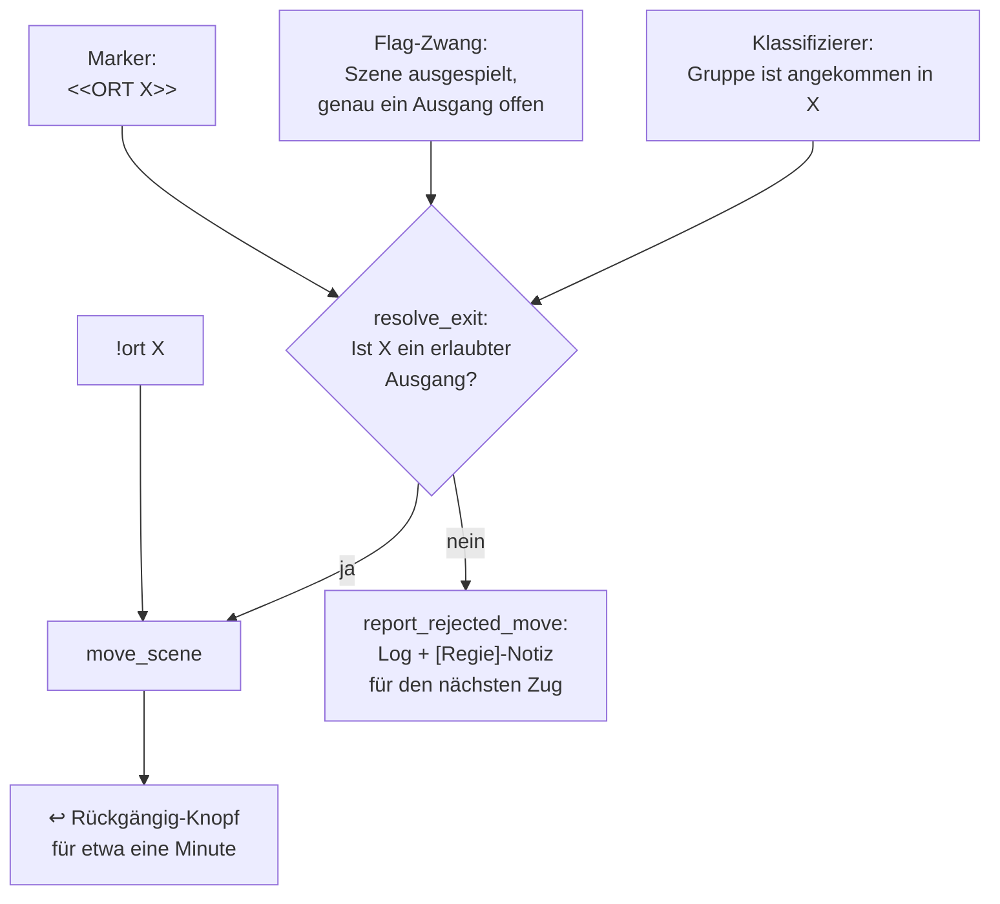

# 6 · Abenteuer und Szenen: Karten, Zeiger, Klassifizierer

Die Kampagne soll ein roter Faden sein, von dem die Gruppe abweichen darf. Gleichzeitig muss
der Bot jederzeit wissen, wo in der Handlung sie steht. Dieses Kapitel zeigt, wie das
Abenteuer vorliegt, wie der „Szenenzeiger“ wandert und was an jeder Zuggrenze geprüft wird.

## Konzept: Zustandsautomat

Ein **Zustandsautomat** ist ein System, das immer in genau einem von mehreren Zuständen ist
und nur über festgelegte Übergänge in einen anderen wechselt. Eine Ampel ist einer: rot,
gelb, grün, mit festen Wechseln.

Das Abenteuer ist hier ein Zustandsautomat. Die Zustände sind die Szenen, die Übergänge sind
die Ausgänge einer Szene (`leads_to`). Der aktuelle Zustand ist eine einzige Zeichenkette im
Weltzustand: `scene_id`. Wie Lebenspunkte gehört dieser Zeiger dem Code. Das Modell darf einen
Wechsel vorschlagen, schreiben darf es ihn nicht.

Der Vorteil gegenüber „das Modell merkt sich schon, wo wir sind“: Am Zeiger hängt fast alles
andere. Welche Karte im Prompt steht, welche NSCs als anwesend gelten, wann NSC-Erinnerungen
extrahiert werden, wie die Spielzeit vorrückt. Wäre der Zeiger falsch, wäre der ganze Abend
falsch.

## Wie das Abenteuer vorliegt

`data/adventures/<id>/`, geladen von `Adventure.load` in `dmbot/rag/adventure.py`:

- `adventure.json`: Titel, Startszene, Startzeit, Fristen, Uhren, Mission, eine
  Zusammenfassung für die Spielleitung (`summary_de`) und die Liste der Szenen.
- `npcs.json`: Werte der NSCs (für `!npc add` und den Kampf).

Eine Szenenkarte, gekürzt aus der Debug-Kampagne:

```jsonc
{
  "id": "zollhaus",
  "title_de": "Die Zoll-Sakristei",
  "part": 1,
  "description_de": "Eine beschlagnahmte Sakristei im Zollhaus …",
  "npcs_here": ["Seneschall Bramwell Kaad"],
  "opportunities_de": [
    { "id": "siegelmeldung",
      "text_de": "Technologie (Routine): Kaads Datentafel die Siegelmeldung entlocken …" },
    { "id": "zollvollmacht",
      "text_de": "Überreden (Herausfordernd): Kaad rückt eine Zollvollmacht heraus …" }
  ],
  "secrets_de": ["Kaad verschweigt auf Halikarns Weisung, was im Ossarium liegt …"],
  "leads_to": [ … ]
}
```

Die Felder und wozu sie dienen:

| Feld | Bedeutung |
|---|---|
| `description_de` | Material für die Beschreibung. Im Prompt mit dem Hinweis versehen, es nicht wörtlich vorzulesen |
| `npcs_here` | Wer in dieser Szene ist. Wird beim Betreten im State registriert |
| `opportunities_de` | Was die Gruppe hier tun kann, mit Fertigkeit und Schwierigkeit als Vorschlag |
| `secrets_de` | Was die Spielleitung weiß, aber nie aussprechen soll |
| `leads_to` | Wohin es von hier weitergeht |

Elemente haben IDs. Wo du keine vergibst, erzeugt der Lader welche (`opp-1`, `opp-2`, …).

Ein Ausgang kann **gesperrt** sein: `{"ziel": "pier_neun", "requires": "zollvollmacht"}`.
Dann ist er unsichtbar und wird abgelehnt, bis das genannte Element dieser Szene abgehakt
ist.

## Szenenelemente abhaken

Der State führt pro Szene eine Menge erledigter Element-IDs (`scene_flags`). Abgehakt wird
auf zwei Wegen:

- Das Modell schreibt `<<ERLEDIGT siegelmeldung>>`. `DeliveryPipeline._handle_erledigt` prüft,
  ob die ID in der aktuellen Szene existiert und nicht schon erledigt ist
  (`erledigt_verdict`). Je nach `DM_FLAG_CONFIRM` erscheint ein Bestätigungsknopf.
- Du tippst `!erledigt <id>` oder `!offen <id>`.

Die Wirkung siehst du im Prompt: Das Element wandert von „Möglichkeiten hier“ nach „Bereits
geschehen“, ein Geheimnis von „Geheimnisse“ nach „Bekannt“. So fragt die Spielleitung nicht
dreimal nach derselben Sache.

## Wie der Zeiger wandert

Es gibt vier Auslöser (`MoveTrigger` in `rules/scene_flow.py`):

| Auslöser | Wer | Wann |
|---|---|---|
| `CLASSIFIER` | der Szenen-Klassifizierer | nach jedem Zug |
| `FLAG_GATE` | reine Logik | wenn alle Möglichkeiten einer Szene abgehakt sind |
| `MARKER` | das Erzählmodell über `<<ORT id>>` | als Rückfallebene |
| `COMMAND` | du über `!ort <id>` | jederzeit |

Die ersten drei laufen durch dasselbe Tor: `SceneFlowMixin.request_scene_move` in
`session/scenes.py`.



### Das Tor: `resolve_exit`

Eine reine Funktion ohne Discord und ohne LLM. Sie lehnt einen Vorschlag mit einem
maschinenlesbaren Grund ab (`MoveRejection`):

| Grund | Bedeutung |
|---|---|
| `NO_TARGET` | leerer Vorschlag |
| `SAME_SCENE` | die Gruppe ist schon dort |
| `UNKNOWN_SCENE` | diese Szene gibt es im Abenteuer nicht |
| `NOT_CONNECTED` | echte Szene, aber von hier kein Ausgang dorthin |
| `LOCKED` | gesperrter Ausgang, Bedingung noch nicht erfüllt |

Eine Ablehnung ist **laut**. `report_rejected_move` schreibt sie ins Log und reiht eine
`[Regie]`-Notiz ein, damit das Modell im nächsten Zug weiß, dass die Gruppe *nicht* dort ist,
wohin es sie gerade erzählt hat. Die erreichbaren Ausgänge stehen in der Notiz, damit es
einen echten wählen kann. In den Spielkanal kommt nichts, was eine gesperrte Szene verraten
würde.

Mit `!ortmodus frei` darf ein automatischer Wechsel in jede Szene springen statt nur zu
Nachbarn (`verbunden` ist der Standard). `!ort` umgeht die Prüfung ganz. Die Geschichte darf eigene Wege gehen.

### Der Umzug: `move_scene`

Ein Szenenwechsel ist mehr als ein Feld zu setzen. `move_scene` erledigt an einer Stelle
alles, was dazugehört:

1. Den alten Stand festhalten (`capture_scene_undo`) für den Rückgängig-Knopf.
2. Zeiger setzen und die NSCs der neuen Karte registrieren (`_set_scene`).
3. Speichern und Prompt-Blöcke neu bauen (`_persist_and_refresh`).
4. Für die verlassene Szene die NSC-Erinnerungen im Hintergrund extrahieren (Kapitel 5).
5. Spielzeit um die Kosten eines Szenenwechsels vorrücken.
6. Anzeigen aktualisieren.
7. Den Wechsel im Kanal ansagen, mit ↩-Knopf.

Der Wechsel passiert **zuerst** und lässt sich danach zurücknehmen. Früher gab es vorab eine
Bestätigung. Die hat am Tisch niemand bemerkt, und die Geschichte blieb stehen. Ein
Mechanismus, den niemand sieht, wirkt nicht.

## Die Zuggrenze: `close_turn`

Nach jedem erzählten Zug, während der Ton noch läuft, ruft die DeliveryPipeline
`SceneFlowMixin.close_turn` auf. Der Ablauf:

1. Zugzähler der Szene erhöhen (steuert, wann Regie-Hinweise wieder in den Prompt kommen).
2. Spielzeit um einen Zug vorrücken.
3. **Momentaufnahme:** aktuelle Szene und Kontext festhalten, bevor irgendetwas wartet.
4. Drei Klassifizierer gleichzeitig starten (`_classify_turn`, ein `asyncio.gather`).
5. Fakten-Urteil anwenden.
6. Anwesenheits-Urteil anwenden.
7. Szenen-Urteil anwenden, oder ersatzweise den Flag-Zwang prüfen.
8. Spieleranzeige aktualisieren.

Alles in einem `try/except`: Ein Fehler hier wird geloggt und berührt den Zug nicht.

### Die drei Klassifizierer

Jeder ist ein eigener kleiner Aufruf mit JSON-Schema, ohne den großen Prompt.

**Szene** (`llm/scene_router.py`). Frage: „Ist die Gruppe tatsächlich an einem dieser Orte
angekommen?“ Die Antwortmöglichkeiten sind genau die erreichbaren Ausgänge der aktuellen
Szene plus `"nein"`. Er sieht die letzte Erzählung, die Spielerzeilen und die neue Antwort.

Warum ein eigener Aufruf, wenn es doch den `<<ORT>>`-Marker gibt? Der Marker steht am Ende
der Antwort, und genau dort schneidet die Längenbegrenzung ab. Eine Entscheidung, an der der
ganze Abend hängt, darf nicht an einer Stelle stehen, die regelmäßig verloren geht. Das ist
dieselbe Einsicht wie beim Roll-Router
(`docs/lessons/mandatory-decisions-need-a-separate-classifier.md`).

**Fakten** (`llm/fact_router.py`). Frage: „Wozu hat sich die Antwort verpflichtet?“ Ein
übergebener Gegenstand, ein angenommener Auftrag, ein gegebenes Versprechen, aus einer
geschlossenen Liste, mit Empfänger aus den echten Figuren am Tisch. Der Code prüft das Urteil
und ruft erst dann `WorldState.record_commitment`. Im Zweifel wird verworfen: Ein falscher
Fakt, der dauerhaft im Prompt steht, ist schlimmer als ein vergessener richtiger.

**Anwesenheit** (`llm/npc_router.py`). Frage: „Wer tritt hier persönlich neu auf?“ Höchstens
vier pro Zug. Hintergrund: Improvisiert die Spielleitung einen Schläger, muss er im State
landen. Sonst bietet die Zielauswahl beim Angriff nur Leute an, die der State schon kennt,
und der Treffer landet bei einem NSC zwei Szenen weiter. Der Code prüft jeden Eintrag: Ein
bekannter NSC wird hierher gesetzt, ein neuer mit den Werten aus dem Abenteuer oder mit
Standardwerten aus dem Profil registriert (`_apply_npc_sightings`).

### Warum die Momentaufnahme in Schritt 3

Die Klassifizierer brauchen einige Sekunden. In dieser Zeit kann jemand `!ort` tippen oder
einen Knopf drücken. Das Szenen-Urteil wurde aber gegen die Ausgänge der *alten* Szene
gebildet. `close_turn` merkt sich deshalb vorher `classified_from` und verwirft das Urteil
stillschweigend, wenn der Zeiger inzwischen woanders steht. Sonst würde ein veraltetes Urteil
laut abgelehnt, und das Modell bekäme die falsche Regie-Notiz „die Gruppe ist nicht dort“,
obwohl sie gerade dorthin gegangen ist.

Das ist die Lektion `docs/lessons/snapshot-state-at-event-time.md` in Reinform: Überall, wo
ein `await` zwischen „Zustand lesen“ und „Zustand benutzen“ liegt, kann sich der Zustand
ändern.

### Der Flag-Zwang

Der Klassifizierer deckt den Fall „Gruppe geht weiter“ ab. Es gibt den umgekehrten Fehler:
Die Gruppe hat einen Raum komplett ausgespielt und niemand bewegt sich. Sind alle
Möglichkeiten einer Szene abgehakt (`is_scene_exhausted`) und gibt es **genau einen** offenen
Ausgang, schiebt der Code weiter (`next_scene_on_exhaustion`). Bei mehreren Ausgängen tut er
nichts. Er rät nie.

## Wer ist hier?

Eine Frage, die an vielen Stellen dieselbe Antwort braucht: im Prompt („NSCs in der Szene“),
beim NSC-Gedächtnis, bei der Zielauswahl im Kampf. Die eine Definition steht in
`NpcMemoryMixin._scene_npcs`: Ein NSC ist anwesend, wenn er lebt und entweder auf der Karte
der Szene steht oder zuletzt hier gesehen wurde.

## Schalter

Alle automatischen Teile lassen sich einzeln abschalten, live per `!automatik <name> an|aus`
oder dauerhaft in der `.env`:

| Name | Schaltet |
|---|---|
| `szene` | den Szenen-Klassifizierer |
| `flaggen` | den Flag-Zwang |
| `fakten` | den Fakten-Klassifizierer |
| `nscs` | den Anwesenheits-Klassifizierer |
| `zeit` | die Spielminuten pro Zug |
| `panel` | die Spieleranzeige |

Fällt einer aus oder ist er aus, bleibt der Zeiger, wo er ist, und du steuerst mit `!ort`.

## Selbsttest

1. Warum ist `scene_id` ein Feld im Weltzustand und nicht etwas, das das Modell im Verlauf
   „weiß“?
2. Der Szenen-Klassifizierer antwortet mit einer Szene, die es gibt, die aber von der
   aktuellen aus nicht erreichbar ist. Was passiert, und was erfährt das Modell?
3. Warum wird beim Szenenwechsel erst gewechselt und dann ein Rückgängig-Knopf angeboten,
   statt vorher zu fragen?
4. Während die Klassifizierer laufen, tippst du `!ort lagerhaus`. Was passiert mit dem
   Szenen-Urteil?
5. Die Spielleitung improvisiert einen Türsteher. Welcher Baustein sorgt dafür, dass ein
   Spieler ihn danach angreifen kann?
6. Alle Möglichkeiten einer Szene sind erledigt, es gibt zwei offene Ausgänge. Was tut der
   Flag-Zwang?
7. Wozu dient `requires` an einem Ausgang?

<details>
<summary>Antworten</summary>

1. Weil an dem Zeiger Prompt-Karte, anwesende NSCs, Zeit und Gedächtnis hängen. Ein Wert, an
   dem so viel hängt, muss exakt und überprüfbar sein. Das Modell darf einen Wechsel nur
   vorschlagen.
2. `resolve_exit` lehnt mit `NOT_CONNECTED` ab. `report_rejected_move` loggt und reiht eine
   `[Regie]`-Notiz ein, die dem Modell sagt, dass die Gruppe geblieben ist und welche
   Ausgänge es gibt.
3. Die Vorab-Bestätigung wurde am Tisch übersehen, und die Geschichte blieb stehen. Der
   sofortige Wechsel mit Rücknahme funktioniert auch, wenn niemand hinsieht.
4. Es wird stillschweigend verworfen, weil der Zeiger nicht mehr dort steht, wo er beim
   Start der Klassifizierung stand (`classified_from`).
5. Der Anwesenheits-Klassifizierer. Er meldet den Neuen, `_apply_npc_sightings` registriert
   ihn mit Werten im State, und die Zielauswahl nutzt dieselbe Anwesenheitsdefinition.
6. Nichts. Bei mehreren Kandidaten wird nicht geraten.
7. Er sperrt den Ausgang, bis ein bestimmtes Element der Szene abgehakt ist. Bis dahin ist
   er im Prompt unsichtbar und wird als Ziel abgelehnt.

</details>

Weiter mit [Kapitel 7: Audio](07-audio.md).
