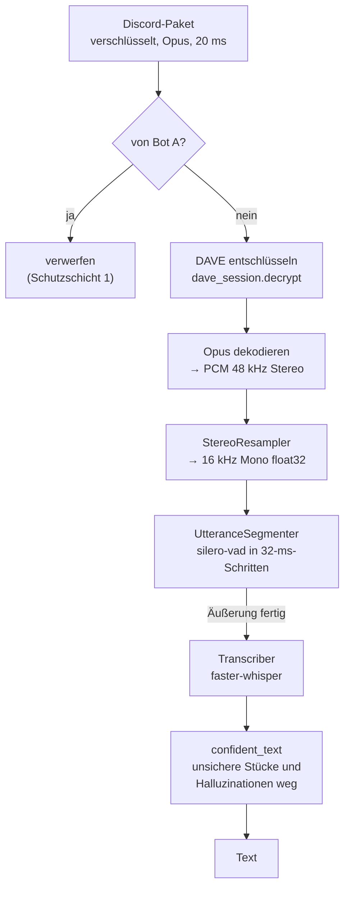
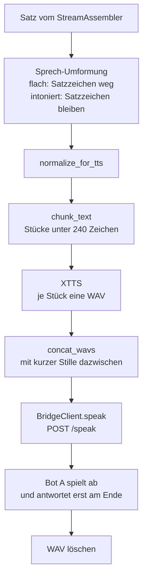

# 7 · Audio: vom Mikrofon zum Text und vom Text zum Lautsprecher

Kapitel 2 hat den Audio-Weg im Vorbeigehen gezeigt. Hier steht, was in jeder Stufe wirklich
passiert und warum sie so gebaut ist. Es ist der Teil des Bots, der am ehesten „still kaputt“
geht: Ein Fehler erzeugt selten eine Fehlermeldung, sondern Stille oder Unsinn.

## Konzept: Was ist digitales Audio?

Ein Mikrofon misst viele Male pro Sekunde den Luftdruck. Jeder Messwert heißt **Sample**.
Drei Kenngrößen beschreiben einen Audiostrom:

- **Abtastrate:** Samples pro Sekunde. 48.000 Hz ist Discord-Standard, 16.000 Hz reicht für
  Sprache und ist das, was Spracherkennung erwartet.
- **Kanäle:** Mono (einer) oder Stereo (zwei).
- **Format:** wie ein Sample gespeichert ist, etwa als 16-Bit-Ganzzahl (`s16le`) oder als
  Kommazahl zwischen −1 und 1 (`float32`).

Rohe Samples nennt man **PCM**. Zum Übertragen werden sie komprimiert, bei Discord mit dem
Codec **Opus**, in Paketen von 20 Millisekunden.

Der wichtigste Merksatz dieses Kapitels: **Ein Audiostrom trägt seine Kenngrößen nicht mit
sich.** Gibst du 48-kHz-Stereo an ein Modell, das 16-kHz-Mono erwartet, gibt es keinen
Fehler. Das Modell hört nur etwas dreifach Verlangsamtes, Verschachteltes und transkribiert
Unsinn.

## Der Hinweg: Mikrofon zu Text

### Empfang und Entschlüsselung

`dmbot/voice/recv.py`. discord.py kann von Haus aus nur senden. Den Empfang liefert die
Zusatzbibliothek `discord-ext-voice-recv`. Sie ruft für jedes Paket `sink.write(user, data)`
auf, und zwar auf ihrem eigenen **Reader-Thread**.

Zwei Besonderheiten haben in der Entwicklung viel Zeit gekostet und stehen deshalb im
Docstring der Datei:

**DAVE.** Discord verschlüsselt Sprachkanäle Ende-zu-Ende. Die Empfangsbibliothek entfernt
nur die Transportverschlüsselung, das Paket ist danach immer noch verschlüsselt. Der Sink
holt sich die `dave_session` der Verbindung und entschlüsselt selbst. Dekodiert man
stattdessen den verschlüsselten Inhalt als Opus, kommt Rauschen heraus, und Whisper macht
daraus erfundene Sätze. Als Warnsystem prüft der Code das Kennzeichen am Paketende
(`0xFAFA`): Kommt ein verschlüsseltes Paket, aber es gibt keine Sitzung zum Entschlüsseln,
warnt er laut und überspringt.

**Selbst dekodieren.** Der Sink sagt der Bibliothek `wants_opus = True`, will also die rohen
Opus-Daten und dekodiert selbst. Ließe man die Bibliothek dekodieren, würde ein einziges
kaputtes Paket ihren ganzen Empfang beenden. So wird ein kaputtes Paket gezählt und
übersprungen.

Das sind Beispiele für die Lektion `docs/lessons/read-the-installed-library-source.md`: Bei
wenig genutzten Bibliotheken stimmt die Dokumentation oft nicht mit der installierten
Version überein. Der Bot prüft deshalb beim Start (`voice/preflight.py`), ob die Stellen, auf
die er sich verlässt, noch da sind.

### Schutzschicht 1: Bot A herausfiltern

Gleich am Anfang von `_write_locked`: Pakete von Bots und von Bot As Benutzer-ID werden
verworfen. Diese Prüfung darf nie entfernt werden, auch nicht zum Testen.

Es gibt eine optionale **Schutzschicht 2** (`DM_PAUSE_VAD_WHILE_SPEAKING`): den VAD
stummschalten, solange Bot A spricht. Sie ist standardmäßig aus, weil Schicht 1 genügt und
der Tisch auch während der Erzählung mitprotokolliert werden soll. Sie hilft, wenn der
Lautsprecher eines Spielers ins eigene Mikrofon überspricht.

Das Stummschalten ist als **Zähler** gebaut und nicht als Ja/Nein-Schalter (`_mute_depth`).
Zwei Stellen können stummschalten: die Sprachausgabe und die Spielpause. Mit einem Schalter
würde das Ende der Pause den VAD öffnen, obwohl Bot A noch spricht. Mit einem Zähler bleibt
er zu, bis beide losgelassen haben.

### Resampling

`dmbot/voice/resample.py`. `StereoResampler.feed` macht zwei Schritte: erst die beiden Kanäle
mitteln (Stereo zu Mono), dann von 48 auf 16 kHz herunterrechnen. Pro Spieler gibt es einen
eigenen Resampler, weil der Filter einen inneren Zustand über die Paketgrenzen hinweg
behält. Würde man jedes 20-ms-Paket einzeln umrechnen, entstünden an jeder Grenze Knackser.

### Segmentieren

`dmbot/voice/vad.py`, in Kapitel 2 beschrieben. Zwei Ergänzungen:

- Das Silero-Modell läuft über `onnxruntime` und braucht dadurch kein PyTorch. Die
  Modelldatei liegt im Repo (`voice/models/silero_vad.onnx`).
- Das Modell erwartet 512 neue Samples **plus** 64 Samples Kontext vom vorigen Schritt, also
  576. Gibt man nur 512, liefert es ohne Fehlermeldung fast immer „keine Sprache“. Auch das
  steht als Warnung im Code.

### Transkribieren

`dmbot/stt/transcriber.py`. Ein eigener Thread mit einer Warteschlange. Er lädt
`faster-whisper` einmal beim Start (auf der GPU mit `float16`, sonst auf der CPU mit `int8`)
und arbeitet dann Äußerung für Äußerung ab.

Einstellungen in `_transcribe_one`, die du kennen solltest:

- `vad_filter=False`: Whispers eigener VAD ist aus, weil schon vorher segmentiert wurde.
- `condition_on_previous_text=False`: Jede Äußerung wird unabhängig erkannt. Sonst könnte
  eine Halluzination die nächste Äußerung „anstecken“.
- `language`: fest auf Deutsch.

### Halluzinationen filtern

**Konzept.** Whisper wurde unter anderem mit untertitelten Videos trainiert. Bekommt es
Stille oder Rauschen, „erkennt“ es typische Untertitel-Floskeln: „Vielen Dank fürs Zuschauen“,
„Untertitel im Auftrag des ZDF“.

**Hier.** `confident_text` in `stt/segments.py` hat zwei Schichten, weil sie verschiedene
Fehler fangen:

- **Nach Sicherheit.** Segmente, bei denen Whisper selbst unsicher ist (hohe
  „keine Sprache“-Wahrscheinlichkeit oder niedrige Erkennungssicherheit), fallen weg.
- **Nach Inhalt.** Eine flüssig erzeugte Floskel hat hohe Sicherheit und rutscht durch die
  erste Schicht. Deshalb prüft `is_stock_phrase_only` den zusammengesetzten Rest: Besteht er
  *nur* aus bekannten Floskeln, wird die ganze Äußerung verworfen. Es gibt „harte“ Floskeln,
  die allein reichen („Untertitel im Auftrag des ZDF“), und „weiche“ wie „Tschüss“, die erst
  ab der zweiten blockieren. Ein einzelnes „Tschüss“ eines Spielers kommt also durch. Enthält
  die Äußerung irgendetwas anderes, bleibt sie ganz erhalten. Der Filter entfernt nie einen
  Teil eines Satzes.

## Der Rückweg: Text zu Lautsprecher

### Die TTS-Engine

Zwei Engines mit derselben Schnittstelle `synthesize(text) -> wav_pfad`:

- **XTTS v2** (`tts/xtts.py`), der Standard: rund 58 eingebaute Stimmen, klingt gut, braucht
  PyTorch und am besten die GPU.
- **Piper** (`tts/piper.py`): schnell und schlank, eine feste deutsche Stimme. Die
  Rückfallebene, wenn XTTS nicht lädt.

Die Engine wird beim Start **im Hintergrund** geladen (`_load_tts` in einem eigenen Thread in
`SessionRuntime.__init__`), damit der Bot schnell bereit ist. `DeliveryPipeline._synthesize`
wartet beim ersten Satz auf das Laden, mit einer Obergrenze. Wird sie überschritten, schaltet
der Bot auf reinen Text um, statt bei jedem Satz zu hängen.

### Text für die Sprachausgabe vorbereiten

`tts/textsplit.py`. XTTS schneidet deutsche Texte über etwa 253 Zeichen einfach ab.
`chunk_text` teilt deshalb in Stücke unter 240 Zeichen, bevorzugt an Satzgrenzen. Lange Sätze
werden zusätzlich an Kommas geteilt, damit beim Zusammenfügen dort eine Atempause entsteht.

In dieser Datei steht auch **die eine Satzende-Regel** des Bots (`SENTENCE_END`): Satzzeichen,
dann schließende Anführungszeichen, dann Leerraum. Jede Stelle, die Sätze trennt, benutzt
sie: der Streaming-Assembler, die TTS-Stückelung, die Aufteilung langer Discord-Nachrichten,
die Säuberungsfilter. Gäbe es mehrere Regeln, wären sie sich bei `“` und `«` irgendwann
uneinig, und gesprochener und gespeicherter Text liefen auseinander.

XTTS neigt dazu, an Satzzeichen zu „brabbeln“. Dagegen gibt es zwei Mittel: eine erhöhte
Wiederholungsstrafe in den Syntheseparametern und den Sprechmodus `flach`, der Satzzeichen
vor der Synthese entfernt. Der im Kanal gepostete Text bleibt davon unberührt.

### Die drei Sprechmodi

Umschaltbar per `!sprechmodus`:

| Modus | Verhalten | Abwägung |
|---|---|---|
| `stream` | Jeder Satz wird gespielt, sobald er fertig ist | schnellster Start, kleine Lücken zwischen Sätzen |
| `puffer` | Erst einige Sätze vorproduzieren, dann spielen | etwas späterer Start, weniger Lücken |
| `nahtlos` | Die ganze Antwort als eine Tonspur | keine Lücken, aber der erste Ton kommt erst, wenn alles synthetisiert ist |

`stream` und `puffer` laufen über `_deliver_streaming`, `nahtlos` über `_speak_seamless`.

### Die Bridge

`dmbot/bridge.py`. `BridgeClient.speak` hat zwei Betriebsarten:

- **Beide Bots auf demselben Rechner** (Standard): Es wird nur der *Dateipfad* geschickt, Bot
  A liest die Datei von derselben Platte.
- **Bots auf verschiedenen Rechnern:** Es werden die *Bytes* der Datei geschickt, mit einem
  gemeinsamen Geheimnis im Header.

In beiden Fällen kehrt der Aufruf erst zurück, wenn Bot A fertig gespielt hat. Schlägt er
fehl, loggt der Client den Grund mit einem Hinweis: 409 heißt „Bot A ist nicht im
Sprachkanal“, 404 „Bot A findet die Datei nicht“, 401 „Geheimnis stimmt nicht“.

WAV-Dateien liegen im Temp-Verzeichnis des Betriebssystems (`tempfile.gettempdir()`), nie
unter einem fest eingetragenen `/tmp`, weil der Bot unter Windows läuft. Jede Datei wird nach
dem Abspielen gelöscht, auch im Fehlerfall (`finally`).

## Die GPU teilen

Whisper, XTTS und bei lokalem Betrieb das Sprachmodell teilen sich eine Grafikkarte. Zwei
Folgen:

- XTTS-Synthesen laufen nacheinander, nicht parallel
  (`docs/lessons/one-cuda-context-one-caller.md`).
- `dmbot/gpu_health.py` erkennt GPU-Fehler und meldet sie verständlich, statt einen
  rohen CUDA-Fehler zu zeigen. Ein Wächter im `DMCog` (`_watch_gpu`) sagt es im Kanal an.

Mit Claude als Erzähler ist die Karte entlastet, weil das Sprachmodell nicht mehr lokal
läuft.

## Fehlersuche: die typischen stillen Fehler

| Symptom | Wahrscheinliche Ursache | Wo nachsehen |
|---|---|---|
| Transkript ist Unsinn | Resampling fehlt oder DAVE-Entschlüsselung kaputt | Log: „DAVE-encrypted frame received but no dave_session“ |
| Nichts wird transkribiert | Opus nicht geladen, oder VAD bekommt falsche Fenstergröße | Log beim Start: „Opus is NOT loaded“ |
| Äußerungen enden nie | `SilenceGeneratorSink` fehlt | `VoiceCog.join` |
| Bot antwortet sich selbst | Bot-A-Filter greift nicht | `BOT_A_USER_ID` in der `.env` |
| Kein Ton, aber Text | Bot A nicht im Kanal, oder TTS nicht geladen | Log: „bridge /speak refused: HTTP 409“ |
| „Vielen Dank fürs Zuschauen“ als Spielerzeile | Whisper-Halluzination durchgerutscht | Log: „🚫 Whisper-Halluzination verworfen“ |

## Selbsttest

1. Warum gibt es keinen Fehler, wenn das Resampling fehlt?
2. Was würde passieren, wenn der Sink verschlüsselte Pakete direkt als Opus dekodiert?
3. Warum hat jeder Spieler einen eigenen Resampler und einen eigenen Segmentierer, aber alle
   teilen sich ein Silero-Modell?
4. Warum ist das Stummschalten des VAD ein Zähler?
5. Ein Spieler sagt nur „Tschüss“. Kommt das beim Brain an? Und „Tschüss, vielen Dank“?
6. Du hörst zwischen den Sätzen der Spielleitung kleine Pausen. Welche zwei Modi verringern
   sie, und was kostet das jeweils?
7. Woran erkennt DMbot, dass Bot A fertig gesprochen hat?

Antworten

1. Weil rohes Audio seine Abtastrate und Kanalzahl nicht mit sich trägt. Das Modell
   interpretiert die Zahlen einfach falsch und liefert Unsinn.
2. Der Decoder würde aus dem Chiffrat Rauschen erzeugen oder scheitern. Whisper macht aus
   Rauschen erfundene Sätze.
3. Resampler und Segmentierer haben einen inneren Zustand, der zum Audiostrom eines Sprechers
   gehört. Das geladene Modell selbst ist zustandslos; der Zustand wird bei jedem Aufruf
   hinein- und herausgereicht.
4. Zwei unabhängige Stellen (Sprachausgabe und Pause) können stummschalten. Mit einem Zähler
   bleibt der VAD zu, bis beide losgelassen haben.
5. „Tschüss“ allein ja: Eine einzelne weiche Floskel blockiert nicht. „Tschüss, vielen Dank“
   besteht nur aus zwei weichen Floskeln und wird verworfen.
6. `puffer` (späterer Start) und `nahtlos` (Start erst nach der ganzen Synthese).
7. Daran, dass der `POST /speak`-Aufruf zurückkehrt. Ein anderes Signal gibt es nicht.

Weiter mit [Kapitel 8: Das LLM-Backend](08-llm-backend.md).
