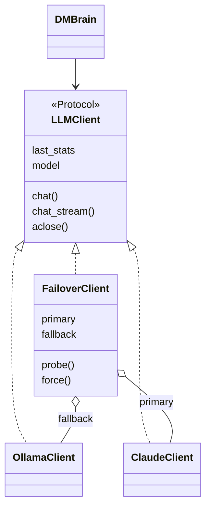
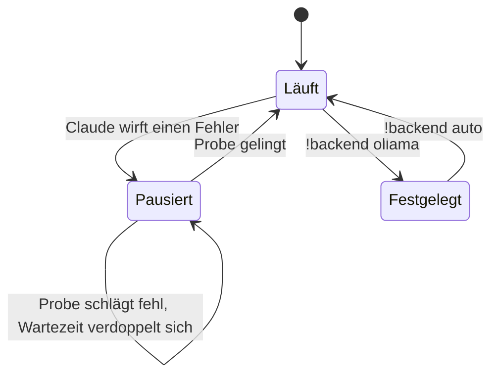

# 8 · Das LLM-Backend: eine Naht, drei Klassen

Der Bot hat mit einem lokalen Modell angefangen und läuft heute mit Claude. Die Umstellung hat
den Rest des Programms kaum berührt. Dieses Kapitel zeigt, warum das so war, wie der
Claude-Zugang technisch funktioniert und was passiert, wenn Claude ausfällt.

## Konzept: Schnittstelle und Naht

Eine **Schnittstelle** legt fest, *was* etwas können muss, ohne zu sagen, *wie*. In Python
heißt das ein `Protocol`: eine Liste von Methoden mit ihren Signaturen. Jede Klasse, die
diese Methoden hat, erfüllt das Protokoll, ohne davon erben zu müssen.

Eine **Naht** (englisch „seam“) ist eine Stelle im Programm, an der man ein Teil gegen ein
anderes tauschen kann, ohne den Rest anzufassen. Eine gut gewählte Schnittstelle erzeugt
eine Naht.

Der Nutzen zeigt sich in drei Situationen: beim Wechsel des Anbieters, beim Testen (man
steckt eine Attrappe hinein, die feste Antworten gibt) und beim Kombinieren (eine Klasse
umhüllt zwei andere und sieht von außen aus wie eine).

## Das Protokoll

`LLMClient` in `dmbot/llm/client.py`:

| Mitglied | Bedeutung |
|---|---|
| `chat(system, messages, options, format)` | ganze Antwort auf einmal. Mit `format` (JSON-Schema) eine strukturierte Antwort |
| `chat_stream(system, messages, options)` | Antwort als Folge von Textstücken |
| `last_stats` | Zahlen zum letzten Erzähl-Aufruf (Tokens, Kontextgröße, wer geantwortet hat) |
| `model` | Name des Modells, für Log und Anzeige |
| `aclose()` | Verbindungen schließen |

Das ist alles, was Brain, Klassifizierer, Extraktoren und Testwerkzeuge vom Modell wissen.

`build_llm_client` in `llm/__init__.py` baut das passende Objekt:

- `DM_LLM_BACKEND=ollama`: ein `OllamaClient`, sonst nichts. Die Claude-Module werden gar
  nicht erst importiert.
- `DM_LLM_BACKEND=claude`: ein `FailoverClient`, der einen `ClaudeClient` und einen
  `OllamaClient` umhüllt.

## `OllamaClient`

Spricht per HTTP mit einem Ollama-Server. Der Host kommt aus der Config und ist nie fest
eingetragen, damit das Modell mit einer Zeile auf einen anderen Rechner umziehen kann.

Ollama wird auch im Claude-Betrieb gebraucht: Die **Einbettungen** für das RAG laufen immer
über Ollama (`bge-m3`), egal wer erzählt.

## `ClaudeClient`

`dmbot/llm/claude_client.py`. Hier steckt die meiste Spezialarbeit. Die Kernpunkte:

### Abo statt API-Schlüssel

Der Client benutzt das `claude-agent-sdk`, das die auf deinem Rechner installierte
`claude`-CLI steuert. Die CLI läuft mit deinem Abo-Login. Es gibt nirgends einen
API-Schlüssel.

Eine Sicherung dazu: Die CLI würde eine gesetzte Umgebungsvariable `ANTHROPIC_API_KEY` dem
Abo-Login vorziehen und damit unbemerkt Kosten erzeugen. Der Client verweigert deshalb den
Start, solange sie gesetzt ist (`_refuse_api_key`).

Das SDK wird erst beim ersten Gebrauch importiert. Wer mit Ollama spielt, braucht es nicht
einmal installiert zu haben.

### Zustandslos

Jeder Aufruf ist ein eigenständiger `query()`-Aufruf des SDK. Es gibt keine fortlaufende
SDK-Sitzung. Der Verlauf gehört allein dem Brain und wird bei jedem Aufruf als Transkript
mitgeschickt (Kapitel 3).

Das klingt verschwenderisch, hat aber einen klaren Grund: Das Brain muss den Verlauf
verändern können. `!redo` ersetzt die letzte Antwort, der Echo-Schutz entfernt ein Paar, der
Auto-Recap leert ihn, nach einem Absturz wird er aus der Datei geladen. Läge der Verlauf in
einer SDK-Sitzung, ginge nichts davon.

### Die Zwei-Modelle-Regel

Der Client entscheidet selbst, welches Modell antwortet, und zwar an der Form des Aufrufs:

| Aufruf | Erkennbar an | Modell |
|---|---|---|
| Erzählung, Recap | kein `format` | Erzählmodell (`CLAUDE_MODEL_NARRATION`, Opus) |
| Klassifizierer, Extraktoren | `format` ist ein JSON-Schema | Hilfsmodell (`CLAUDE_MODEL_AUX`, Haiku) |

Keine Aufrufstelle im Programm nennt ein Modell. Soll ein Klassifizierer auf ein anderes
Modell, änderst du eine Config-Zeile.

### Abschottung

Die CLI ist ein Programmierwerkzeug. Ohne Gegenmaßnahme würde sie die `CLAUDE.md` dieses
Repos, deine Skills, Einstellungen und MCP-Server in den Kontext der Spielleitung laden. Der
Client schaltet jede dieser Quellen ausdrücklich ab und lässt die CLI in einem leeren
Arbeitsverzeichnis laufen (`_options`). Werkzeuge hat das Modell keine.

Die zugehörige Lektion: `docs/lessons/isolation-must-enumerate-every-artifact.md`. „Isoliert“
heißt erst dann isoliert, wenn jede einzelne Quelle aufgezählt und abgeschaltet ist.

### Was sich nicht übertragen lässt

Ollama kennt Stellschrauben, die es bei Claude so nicht gibt:

| Ollama | Bei Claude |
|---|---|
| `temperature` | nicht einstellbar; wird einmal im Log vermerkt |
| `stop`-Sequenzen auf dem Server | gibt es nicht; die Label-Filter oberhalb der Naht übernehmen allein |
| `repeat_penalty`, `top_p` | entfallen stillschweigend |
| `num_ctx` | nur ein nominelles Budget für den Auto-Recap |

Der Client lässt diese Optionen fallen, statt einen Fehler zu werfen. Die Schutzfilter im
Brain (Kapitel 2, Schritt 7) waren schon vorher doppelt ausgelegt und tragen jetzt allein.

### Die Längenbegrenzung

`num_predict` bedeutet überall im Bot „höchstens so viel Text, denn er wird vorgelesen“. Bei
Claude ließ sich das nicht einfach an die CLI weiterreichen: Sie begrenzt nur eine einzelne
Anfrage und bittet das Modell dann, fortzusetzen. Deshalb schneidet der Client selbst, am
Text: nach so vielen Zeichen, wie `num_predict` Tokens bei Nemo ungefähr ergeben hätten. Eine
gekürzte Antwort meldet sich im Log mit `✂`.

### Strukturierte Antworten

Ollama erzwingt ein JSON-Schema schon beim Erzeugen. Bei Claude kommt eine strukturierte
Antwort als Werkzeugaufruf zurück. Der Client gibt solchen Aufrufen bis zu drei Runden und
hängt an den System-Prompt die Zeile an, die Antwort ausschließlich über dieses Werkzeug zu
geben. Kommt kein Urteil, gilt es als verlorenes Urteil. Der Aufrufer macht dann ohne weiter
(fail open). Es zählt nicht als Ausfall des Backends.

## `FailoverClient`

`dmbot/llm/failover.py`. Er sieht von außen aus wie ein `LLMClient` und hat innen zwei. Was
bei einem Fehler des ersten passiert, bestimmt `DM_LLM_ON_FAILURE`.

### Stellung `pause` (dein Standard)

- Der fehlgeschlagene Aufruf und jeder weitere bis zum nächsten Versuch werfen
  `LLMPausedError`. Nichts geht an Ollama.
- Am Tisch erscheint **ein** ⏸-Hinweis pro Ausfall, in Text und Stimme. Nicht einer pro Zug.
- Das Brain hebt den unbeantworteten Zug auf (`_hold_turn`, Kapitel 2).
- Der Wächter `DMCog._watch_backend` schläft bis zum nächsten fälligen Versuch und lässt den
  Client dann prüfen (`probe`). Die Wartezeit beginnt bei `DM_LLM_PAUSE_RETRY_S` und
  verdoppelt sich bis höchstens 300 Sekunden. Meldet Claude ein Rate-Limit mit Rücksetzzeit,
  wird bis dahin gewartet.
- Kommt Claude nach einer kurzen Pause zurück (kürzer als `DM_LLM_PAUSE_AUTO_TURN_S`),
  beantwortet der Wächter den aufgehobenen Zug von selbst. Nach einer langen Pause sagt der
  Bot an, dass er wieder da ist, und wartet auf eure nächste Zeile. Das Aufgehobene
  beantwortet er dann mit.

Die Probe ist der kleinstmögliche Aufruf derselben Art, die gescheitert ist: ein Erzähl-Ping
prüft das Erzählmodell, ein Schema-Ping das Hilfsmodell. Den anderen zu prüfen, würde eine
Rückkehr melden, mit der der nächste Zug nichts anfangen kann.

### Stellung `fallback`

Derselbe Aufruf wird sofort bei Ollama wiederholt, mit einer ⚠-Zeile pro Ausfall. Nach einer
Abkühlzeit (`DM_LLM_FAILOVER_COOLDOWN_S`) wird Claude wieder versucht, die Rückkehr wird
einmal angesagt. Diese Stellung kostet Qualität statt Spielzeit.

### Die Streaming-Regel

In beiden Stellungen gilt: Ein Stream wird nur **vor dem ersten Textstück** vom ersten Client
weggenommen. Ist schon Text geflossen, kann er bereits gesprochen sein. Eine zweite Antwort
obendrauf wäre schlimmer als eine abgebrochene. Der Fehler wird dann nach oben gereicht, und
das Brain behält den gesprochenen Teil (`_run_turn` vermerkt „Antwort unterbrochen“ im
Verlauf).

### Von Hand umschalten

`!backend` zeigt den Stand. `!backend ollama` legt für diese Sitzung das lokale Modell fest,
`!backend claude` Claude, `!backend auto` gibt die Entscheidung an die Automatik zurück.

### Nichts geschieht still

Jeder Wechsel wird als Fehler geloggt, am Tisch angesagt, und `last_stats` nennt das Modell,
das tatsächlich geantwortet hat. Dahinter steht die Lektion
`docs/lessons/unwired-knobs-and-silent-fallbacks.md`: Eine Rückfallebene, die still
einspringt, versteckt Fehler. Du würdest einen ganzen Abend mit dem schwächeren Modell
spielen und dich wundern, warum es so schlecht läuft.

## Prüfung beim Start

`dmbot/llm/preflight.py`, aufgerufen in `__main__.main`:

- `check_ollama`: Ist der Server erreichbar, ist das Modell vorhanden?
- `check_claude` (nur im Claude-Betrieb): Wird die CLI gefunden, ist sie eingeloggt,
  antworten beide Modellstufen auf einen Ping?

Beides ist „best effort“: Der Bot startet trotzdem. Aber du siehst die Ursache beim Start in
einer klaren Zeile und nicht mitten im Spiel als kryptischen Verbindungsfehler. Das ist die
Lektion `docs/lessons/incidents-become-preflights.md`: Jeder Vorfall am Spieltisch wird zu
einer Prüfung beim Start.

## Selbsttest

1. Welche Klasse müsste sich ändern, wenn du einen dritten Anbieter einbauen willst, und
   welche nicht?
2. Woran erkennt der `ClaudeClient`, ob ein Aufruf an Opus oder an Haiku gehen soll?
3. Warum verwaltet das Brain den Verlauf und nicht eine SDK-Sitzung?
4. Warum verweigert der Bot den Start mit gesetztem `ANTHROPIC_API_KEY`?
5. Claude fällt aus, nachdem die Spielleitung zwei Sätze gesprochen hat. Was passiert in der
   Stellung `pause`, und warum wird der Zug nicht einfach neu gestartet?
6. Claude kommt nach 20 Minuten Ausfall zurück. Antwortet der Bot von selbst auf den
   aufgehobenen Zug?
7. Wozu wird Ollama im Claude-Betrieb noch gebraucht?

Antworten

1. Eine neue Klasse, die `LLMClient` erfüllt, und `build_llm_client`. Brain, Klassifizierer,
   Cogs und Tests bleiben unverändert.
2. Am Parameter `format`. Ist ein JSON-Schema gesetzt, geht der Aufruf an das Hilfsmodell,
   sonst an das Erzählmodell.
3. Weil `!redo`, Echo-Schutz, Auto-Recap und die Wiederherstellung nach einem Absturz den
   Verlauf verändern müssen.
4. Weil die CLI den Schlüssel dem Abo-Login vorziehen und damit unbemerkt über die API
   abrechnen würde.
5. Es ist bereits Text geflossen, also wird der Stream nicht umgeleitet und der Zug nicht
   aufgehoben. Der gesprochene Teil bleibt mit dem Vermerk „Antwort unterbrochen“ im Verlauf.
   Das Backend gilt ab jetzt als pausiert, der nächste Zug wird aufgehoben. Neu starten würde
   eine zweite Antwort über die schon gehörte legen.
6. Nein, sofern `DM_LLM_PAUSE_AUTO_TURN_S` kürzer eingestellt ist. Nach einer langen Pause
   wartet der Bot, bis wieder jemand spricht.
7. Für die Einbettungen des RAG und, je nach Stellung, als Rückfallebene.

Weiter mit [Kapitel 9: Testen](09-testen.md).
