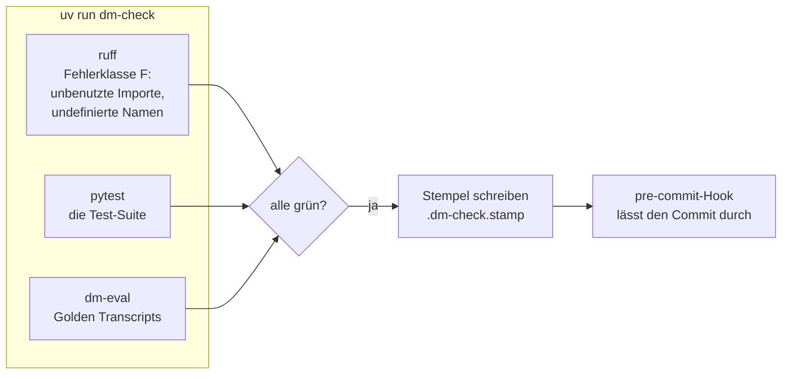
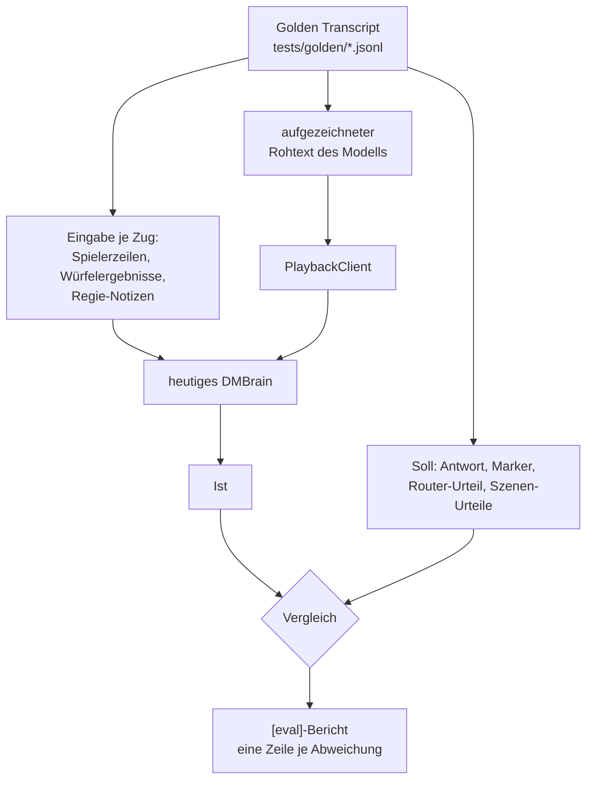

# 9 · Testen: Fakes, Golden Transcripts, `dm-eval`, `dm-check`

Ein Programm mit Sprachmodell, Audio und Discord lässt sich nicht einfach „durchtesten“: Das
Modell antwortet jedes Mal anders, Audio braucht Hardware, Discord einen Server. Dieses
Kapitel zeigt, wie das Repo trotzdem rund 1500 Tests hat und was die drei Prüfwerkzeuge
jeweils leisten.

## Konzept: Was lässt sich überhaupt prüfen?

Ein Test ruft Code mit bekannter Eingabe auf und vergleicht das Ergebnis mit einer Erwartung.
Das geht nur bei **deterministischem** Code: gleiche Eingabe, gleiche Ausgabe.

Der Bot hat drei Arten von Code:

| Art | Beispiel | Testbar? |
|---|---|---|
| deterministisch und rein | Würfelauswertung, Marker-Erkennung, Szenenregeln | direkt |
| deterministisch, aber mit Abhängigkeiten | Zugablauf im Brain, Cogs | mit Attrappen für die Abhängigkeiten |
| nicht deterministisch | was das Modell schreibt, wie XTTS klingt | nicht automatisch; nur am Tisch |

Die Architektur ist so gebaut, dass möglichst viel in die erste Zeile fällt. Deshalb gibt es
so viele „reine“ Module (`rules/`, `memory/`, `llm/sanitize.py`, `llm/stream_assembler.py`),
die weder Discord noch ein Modell importieren.

Zwei Begriffe dazu:

- **Attrappe** (englisch „fake“ oder „mock“): ein Ersatzobjekt, das sich wie das echte
  verhält, aber vorhersagbar. Eine LLM-Attrappe gibt feste Antworten zurück.
- **Regressionstest:** prüft nicht, ob etwas *gut* ist, sondern ob es sich *nicht verändert*
  hat. Das ist genau, was man bei einem Umbau wissen will.

## Die drei Werkzeuge



### 1 · Die Test-Suite

`tests/`, über hundert Dateien, benannt nach dem, was sie prüfen (`test_combat.py`,
`test_echo_guard.py`, `test_delivery.py`). Einzelne Datei ausführen:

```
uv run --with pytest python -m pytest tests/test_combat.py
```

(`pytest` ist absichtlich keine Projektabhängigkeit, deshalb `--with`.)

**Wann wird zuerst der Test geschrieben?** `CLAUDE.md` regelt das: Für Regeln im
deterministischen Kern mit echter Logik kommt der Test zuerst. Triviale Ergänzungen bekommen
einen Test nebenher. Persona, Prompts, Recaps, RAG und Discord-Verklebung werden über
`dm-check` und einen Live-Lauf geprüft, weil ein Test dort wenig aussagt.

### 2 · Die Attrappen: `tests/fakes.py`

Das Kernstück der Testbarkeit. Drei Bausteine:

- **`FakeLLMClient`** erfüllt das `LLMClient`-Protokoll (Kapitel 8) und gibt vorgegebene
  Antworten zurück. Hier zahlt sich die Naht aus.
- **`FakeBrain`** ist ein *echtes* `DMBrain` über einem `FakeLLMClient`. Ein Test überschreibt
  nur die Methoden, die er steuern will, zum Beispiel `classify_scene_move`. Alles andere ist
  der echte Code.
- **`make_runtime`** lässt den *echten* `SessionRuntime.__init__` laufen und tauscht nur die
  schweren Ränder aus: Sprach-Preflight, STT-Thread, TTS-Ladethread, LLM-Client, RAG-Speicher,
  HTTP-Client der Bridge.

Der dritte Punkt ist eine bewusste Entscheidung mit einer Lektion dahinter
(`docs/lessons/complete-fakes-not-production-guards.md`). Die Alternative wäre ein
halbfertiges Test-Objekt, dem Attribute fehlen. Dann muss der Produktionscode überall
`getattr(self, "x", None)` schreiben, nur damit Tests nicht abstürzen. Solche Schutzabfragen
verstecken später echte Fehler. Mit vollständigen Attrappen greift der Produktionscode direkt
auf seine Attribute zu, und kommt in `__init__` ein neues dazu, haben es die Tests
automatisch auch.

`make_config` liefert eine vollständige Config, in der alle optionalen Schichten **aus** sind.
Ein Test schaltet genau das ein, was er prüft.

### 3 · `dm-eval`: Golden Transcripts

`dmbot/tools/eval_replay.py`, Aufruf `uv run dm-eval`.

**Konzept: Golden-Test.** Man zeichnet einmal auf, was das Programm bei einer bestimmten
Eingabe tut, und speichert das als „goldene“ Referenz. Später lässt man das Programm dieselbe
Eingabe noch einmal verarbeiten und vergleicht. Jede Abweichung ist entweder ein Fehler oder
eine gewollte Änderung, die man bewusst bestätigt.

**Das Problem hier.** Das Modell ist nicht deterministisch. Die Lösung: Das Modell wird
eingefroren. Das Journal (Kapitel 5) enthält für jeden Zug den **rohen Modelltext**. Beim
Abspielen gibt eine Attrappe (`PlaybackClient`) genau diesen Text zurück. Geprüft wird dann
alles, was der Code *um das Modell herum* daraus macht.



Verglichen wird in sechs Kategorien:

| Kategorie | Prüft |
|---|---|
| `turn` | Wird die User-Nachricht noch gleich zusammengesetzt? |
| `answer` | Macht die Säuberung aus demselben Rohtext noch dieselbe Antwort? |
| `marker` | Werden dieselben Marker erkannt und eingereiht oder unterdrückt? |
| `router` | Fällt der Roll-Router dasselbe Urteil? |
| `state` | Fallen die Urteile zu Szene, Flags, Uhren und Zeit gleich aus? |
| `llm` | Wird das Modell noch gleich oft aufgerufen? |

Rückgabewerte: 0 heißt grün, 1 heißt Abweichungen, 2 heißt unbrauchbares Transcript.

**Was `dm-eval` nicht prüft:** ob die Erzählung gut ist, wie lange etwas dauert, wie es
klingt, was im Prompt steht. Der Merksatz aus dem ADR: „Regression, nicht Qualität.“

**Warum das für dich wichtig ist.** `dm-eval` ist das Pflicht-Tor für Umbauten. Die
Mixin-Aufteilung hat tausende Zeilen verschoben. Dass `dm-eval` danach grün war, belegt: Der
Bot macht aus denselben Modellantworten noch genau dasselbe. Ohne dieses Werkzeug hättest du
das nur durch einen Spielabend herausfinden können.

#### Goldens pflegen

`tests/golden/README.md` beschreibt es im Detail. Kurz:

- **Bestand:** `dice_flow.jsonl` (Würfelablauf) und `scene_flags.jsonl` (Szenenwechsel und
  Flags). Beide sind synthetisch und werden von `tests/golden/generate_synthetic.py` über den
  echten Aufzeichnungspfad erzeugt. Sie nutzen ein eigenes Mini-Abenteuer unter
  `fixtures/mini_adventure/`, damit keine Buchinhalte im öffentlichen Repo landen.
- **Aus einer echten Sitzung:** nach `!leave` das rotierte Journal kopieren, auf eine Handvoll
  interessanter Züge kürzen, `uv run dm-eval <datei>` muss sofort grün sein, einchecken.
- **Nach einer gewollten Verhaltensänderung:** Bericht lesen, prüfen, dass *nur* die
  beabsichtigte Kategorie abweicht, dann neu erzeugen. Nie von Hand „grün editieren“. Die
  Goldens sind der Vertrag.

### 4 · `dm-check`: ein Urteil

`dmbot/tools/dm_check.py`, Aufruf `uv run dm-check`. Führt ruff, die Test-Suite und `dm-eval`
nacheinander aus und gibt ein Gesamturteil.

Der Kniff ist der **Stempel**. Bei Grün schreibt `dm-check` einen Fingerabdruck von `dmbot/`,
`tests/` und `data/systems/` in `.dm-check.stamp`. Der pre-commit-Hook (`tools/hooks/pre-commit`)
fragt mit `dm-check --fresh`, ob der Stempel noch zum Arbeitsverzeichnis passt. Wenn ja,
läuft beim Commit nichts noch einmal. Wenn nein, läuft `dm-check`.

Der Fingerabdruck ist der Git-Baum-Hash dieser drei Ordner. Jede Änderung, Löschung oder neue
Datei ändert ihn. Drei Regeln verhindern, dass ein veralteter Stempel durchrutscht:

- Der Stempel wird **vor** den Prüfungen gelöscht. Ein roter oder abgebrochener Lauf
  hinterlässt keinen.
- Geschrieben wird nur, wenn der Fingerabdruck nach den Prüfungen derselbe ist wie davor.
- Ein fehlender oder unlesbarer Stempel zählt als „nicht frisch“.

Für Claude Code gilt laut `CLAUDE.md`: Eine Fertig-Meldung stützt sich auf ein
`dm-check`-Ergebnis aus derselben Sitzung. Alles, was nicht am Tisch erprobt ist, wird als
„live-unverified“ markiert.

## Was nur der Tisch zeigt

Automatische Tests decken die Maschinerie ab. Für den Rest gibt es eigene Hilfen:

- **Die Debug-Kampagne** (`data/adventures/debug-kampagne/`): ein kurzes Abenteuer, das jede
  Mechanik einmal auslöst. Mit `testplan.json` daneben blendet der Bot eine Prüfliste ein
  (`docs/debug-campaign-runbook.md`). Läufe damit landen in einem abgetrennten
  Gedächtnisbereich und verschmutzen die echte Kampagne nicht.
- **`python -m dmbot.tools.text_replay`**: spielt einige echte Züge mit verschiedenen
  Persona-Varianten durch das echte Erzählmodell und misst Länge und Satzlänge. So siehst du,
  was eine Änderung an `dm_core_de.md` bewirkt, bevor der Tisch sie hört
  (`docs/lessons/measure-persona-changes-on-replayed-turns.md`).
- **Die `[latency]`-Zeile** im Log: pro Zug die Dauer jeder Stufe (STT, LLM, TTS, Bridge).
- **`docs/live-test-checklist.md`** und **`docs/lessons/one-variable-per-live-run.md`**: Pro
  Spielabend nur eine Sache ändern, sonst weißt du nicht, was gewirkt hat.

## Selbsttest

1. Warum kann `dm-eval` trotz nicht deterministischem Modell ein verlässliches Ergebnis
   liefern?
2. Nach einem Umbau meldet `dm-eval` eine Abweichung in der Kategorie `answer`, sonst nichts.
   Was hat sich wahrscheinlich geändert?
3. Du hast die Marker-Grammatik absichtlich erweitert, `dm-eval` wird rot. Wie gehst du vor?
4. Warum läuft in `make_runtime` der echte `__init__` und kein vereinfachter Nachbau?
5. Du committest zweimal hintereinander, ohne zwischendurch Code zu ändern. Warum läuft
   `dm-check` beim zweiten Mal nicht?
6. Du willst wissen, ob eine kürzere Persona die Antworten wirklich kürzer macht. Welches
   Werkzeug, und warum nicht `dm-eval`?

<details>
<summary>Antworten</summary>

1. Weil die Modellantworten aufgezeichnet sind und beim Abspielen unverändert zurückgegeben
   werden. Geprüft wird nur der deterministische Code darum herum.
2. Die Textsäuberung (`llm/sanitize.py` oder `finalize_answer`): Aus demselben Rohtext
   entsteht eine andere gesprochene Antwort.
3. Den Bericht lesen und prüfen, dass nur `marker` abweicht. Dann die synthetischen Goldens
   mit dem Generator neu erzeugen und den Git-Diff der `.jsonl`-Dateien durchsehen: Jede
   geänderte Zeile ist eine Verhaltensänderung, die du damit absegnest.
4. Damit jedes Attribut existiert, das der Produktionscode erwartet, und neue Attribute
   automatisch auch in den Tests da sind. Sonst bräuchte der Produktionscode Schutzabfragen
   nur für Tests.
5. Der Stempel vom ersten grünen Lauf passt noch zum Fingerabdruck der drei Ordner. Der Hook
   sieht „frisch“ und überspringt die Prüfung.
6. `text_replay`. `dm-eval` friert die Modellantworten ein und kann deshalb nichts darüber
   sagen, wie das Modell auf eine andere Persona reagiert.

</details>

Weiter mit [Kapitel 10: Warum so?](10-warum-so.md).
